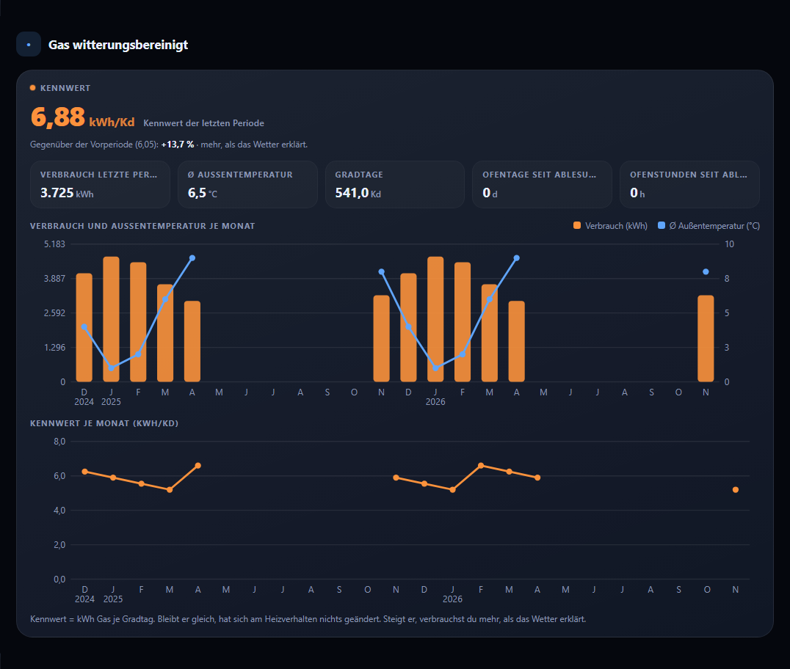

# Tarif-Cockpit

Kosten, Abschläge und Jahresprognose für Strom, Gas und Wasser auf einen Blick: **passt, Nachzahlung oder Rückzahlung**.
Zwei Karten für Home Assistant im Stil von [energy-cockpit](https://github.com/msucimaker3112/energy-cockpit), mit denselben Farbschemen, auf Deutsch und Englisch.


## Die zwei Karten

| Karte | Zeigt |
|---|---|
| `custom:tarif-cockpit-card` (Tarifübersicht) | Je Medium eine Kachel mit Urteil, Betrag und vier Balken: Kosten bisher, Abschläge bisher, Hochrechnung fürs Jahr, Abschläge fürs Jahr (grün). Dazu den passenden monatlichen Abschlag, oben das Gesamturteil, unten frei wählbare Kacheln. |
| `custom:tarif-cockpit-analyse-card` (Auswertung) | Gas witterungsbereinigt: Kennwert je Gradtag, Vergleich mit der Vorperiode, Kacheln für Verbrauch, Außentemperatur und Gradtage sowie Verlauf aus der Langzeitstatistik. |



Die Karten **rechnen die Prognose nicht selbst** (Sensor-Modus). Sie zeigen, was deine Sensoren liefern, und bilden daraus nur das Urteil:
`Differenz = Abschlag × Monate − Hochrechnung`. Positiv heißt Rückzahlung, negativ Nachzahlung. Liegt die Differenz unter 5 % der Abschläge, steht dort „Passt“.
Wie man die Sensoren baut, steht in [docs/SENSOR-MODUS.md](docs/SENSOR-MODUS.md). Ab Version 0.6 rechnet eine mitgelieferte Integration die Prognose selbst; der Sensor-Modus bleibt als Rückfallebene erhalten.

## Installation

Ab Home Assistant 2026.11 heißt HACS **Marketplace** und ist eingebaut (Einstellungen → Marketplace).

1. **Aus dem Katalog** (sobald Tarif-Cockpit dort gelistet ist): Einstellungen → Marketplace, nach „Tarif-Cockpit“ suchen, herunterladen.
2. **Als eigenes Repository** (bis dahin): Einstellungen → Marketplace → Menü oben rechts → **Benutzerdefinierte Repositories**, `https://github.com/HasenbeinMH/tarif-cockpit` eintragen, Kategorie **Dashboard**, dann „Tarif-Cockpit“ herunterladen. Dafür muss der Marketplace mit GitHub verbunden sein (fragt er bei der Einrichtung ab).
3. Browser-Cache leeren (Strg+F5).
4. Dashboard bearbeiten → Karte hinzufügen → **Tarif-Cockpit** bzw. **Tarif-Cockpit Auswertung**.

Mit Home Assistant 2026.10 oder älter gilt derselbe Weg über **HACS** (HACS → Menü → Benutzerdefinierte Repositories, Kategorie Dashboard).

Die Beschriftung des Menüpunkts kann je nach Version leicht abweichen. Siehst du einen anderen Weg, freue ich mich über ein Issue.

## Einrichten mit dem Editor

Beim Hinzufügen schlägt die Karte passende Sensoren aus deinem Home Assistant vor. Fehlen sie, steht dort „Noch nicht eingerichtet“, und der Karten-Editor öffnet mit dem **Assistenten**:

| 1. Medien wählen | 2. Sensoren mit Vorschlägen | 3. Zusammenfassung |
|---|---|---|
|  |  |  |

- Je Feld stehen oben die **Vorschläge** (nach Einheit, Geräteklasse und Stichwörtern), darunter alle passenden Entitäten. „Vorschlag übernehmen“ setzt den besten Treffer, darunter steht der Wert der gewählten Entität.
- Schritte für nicht gewählte Medien entfallen.
- Der Reiter **Alle Felder** zeigt das Formular von Home Assistant mit allen Optionen.

## Konfiguration in YAML

### Tarifübersicht

```yaml
type: custom:tarif-cockpit-card
title: Tarife und Abrechnung
period_start: input_datetime.abrechnung_strom_beginn   # Beginn des Abrechnungszeitraums, in HA änderbar
theme: dunkel          # dunkel, graphit, hell, warm, auto, ha
tolerance_pct: 5       # ab welcher Abweichung nicht mehr "Passt" gilt
strom:
  cost: sensor.kosten_strom_abrechnungsjahr             # Kosten seit Abrechnungsbeginn
  advance_paid: sensor.abschlage_strom_abrechnungsjahr  # bisher gezahlte Abschläge
  forecast_cost: sensor.prognose_strom_kosten           # Hochrechnung bis Jahresende
  forecast_kwh: sensor.prognose_strom_verbrauch         # optional, Hochrechnung in kWh
  advance: input_number.abschlag_strom                  # monatlicher Abschlag
gas:
  cost: sensor.kosten_gas_abrechnungsjahr
  advance_paid: sensor.abschlage_gas_abrechnungsjahr
  forecast_cost: sensor.prognose_gas_kosten
  forecast_kwh: sensor.prognose_gas_verbrauch
  advance: input_number.abschlag_gas
footer:
  - { name: Strombezug, entity: sensor.zahler_strombezug }
  - { name: Letzte Ablesung, entity: input_datetime.zahler_letzte_ablesung, format: date }
  - { name: Strom Arbeitspreis, entity: input_number.tarif_strom_arbeitspreis, scale: 100, unit: ct/kWh, decimals: 2 }
```

Die Entitätsnamen sind Beispiele. Die Karte nimmt jeden Sensor, den du einträgst.

| Option | Bedeutung |
|---|---|
| `strom`, `gas`, `wasser` | Je Medium: `cost`, `advance_paid`, `forecast_cost`, `forecast_kwh` (optional), `advance`. Weitere Felder: `name`, `color` (`#hex`), `months` (Abschläge pro Jahr, Standard 12), `start` (eigener Beginn), `advance_color`, `stale_hint` (Hinweistext) |
| `title`, `subtitle`, `icon` | Kopfzeile |
| `period_start` | Beginn des Abrechnungszeitraums: Datums-Helfer (`input_datetime`, Sensor) oder Text `2026-07-30`. Die Karte zeigt „Abrechnungszeitraum 30.07.2026 – 29.07.2027“. Ist es eine Entität, öffnet ein Tipp darauf den Helfer. Ersetzt `subtitle` |
| `period_end` | Optional, sonst ein Jahr nach dem Beginn minus ein Tag |
| `theme` | Farbschema wie bei energy-cockpit |
| `tolerance_pct` | Schwelle für „Passt“, Standard 5 |
| `advance_color` | Farbe der Abschlagsbalken, Standard grün (`#34d399`, in hellen Schemen dunkler). Auch je Medium möglich |
| `footer` | Liste von Kacheln mit `entity`, `name`, `unit`, `decimals`, `scale`, `format: date` |
| `analysis` | **Veraltet**, weiterhin angezeigt. Bitte die Auswertungskarte verwenden, siehe [docs/MIGRATION.md](docs/MIGRATION.md) |

Fehlt ein Sensor oder ist er nicht verfügbar, zeigt die Kachel „Noch keine Prognose“ bzw. „—“. Nicht eingetragene Zeilen entfallen.

### Auswertung

```yaml
type: custom:tarif-cockpit-analyse-card
title: Gas witterungsbereinigt
kennwert: sensor.gas_kennwert_je_gradtag          # kWh je Gradtag
kennwert_previous: input_number.gas_kennwert_vorperiode   # optional, für den Vergleich
consumption: sensor.gas_verbrauch_letzte_periode  # kWh
temperature: sensor.gas_aussentemperatur_letzte_periode   # °C
degree_days: sensor.gas_gradtage_letzte_periode
extras:                                           # beliebige weitere Kacheln, z. B. Kaminofen
  - { name: Ofentage seit Ablesung, entity: input_number.ofentage_periode, unit: d, decimals: 0 }
explain: Kennwert = kWh Gas je Gradtag. Bleibt er gleich, hat sich am Heizverhalten nichts geändert.
months: 24          # Monate im Verlauf (höchstens 36)
history: true       # false blendet die Diagramme aus
color: '#fb923c'
theme: dunkel
```

Weitere Optionen: `subtitle`, `icon`, `label` (Überschrift im Panel, Standard „Kennwert“), `pending_text` (Text, solange kein Kennwert vorliegt).

## Farbschemen

| dunkel | hell | warm |
|---|---|---|
|  |  |  |

Dazu `graphit`, `auto` (folgt dem hellen/dunklen Design von Home Assistant) und `ha` (Farben des HA-Themes). Sprache, Zahlenformat und Währung kommen aus Home Assistant.

Weitere Beispiele (Mietwohnung nur Strom, Strom/Gas/Wasser, Nachzahlung, fehlende Prognose) stehen in [docs/BEISPIELE.md](docs/BEISPIELE.md).

## Entwickeln und testen

- Quellen in `src/`, Build ohne Abhängigkeiten: `node tools/build.mjs` erzeugt `tarif-cockpit.js`. Die gebaute Datei wird mit eingecheckt, der Marketplace lädt sie direkt.
- Testseiten: `python -m http.server` im Repo, dann `http://localhost:8000/test/` öffnen. Szenarien und Farbschemen lassen sich oben umschalten.
- Screenshots: `pip install playwright`, `python -m playwright install chromium`, dann `python tools/make-screenshots.py` (schreibt nach `docs/img/`).
- Änderungen: [CHANGELOG.md](CHANGELOG.md).

## Hinweis

Die Karten liefern eine Hochrechnung und ersetzen keine Abrechnung deines Versorgers.

## Lizenz

MIT, siehe [LICENSE](LICENSE). Editor-Baukasten, Assistent und Build-Aufbau sind nach [energy-cockpit](https://github.com/msucimaker3112/energy-cockpit) entstanden (MIT License, Copyright (c) 2026 Musicmaker3112).
