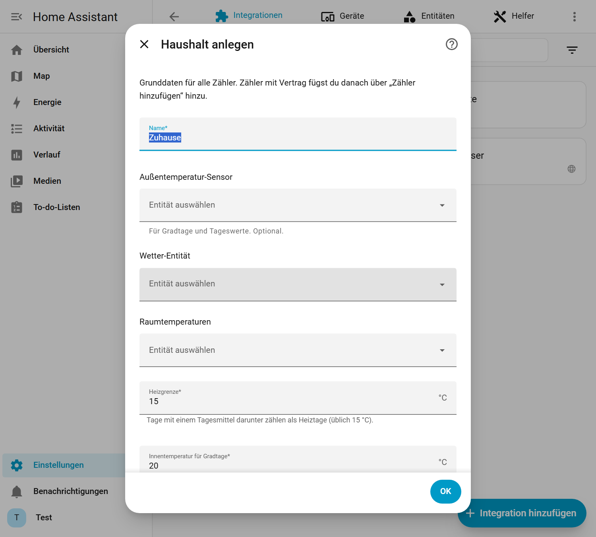
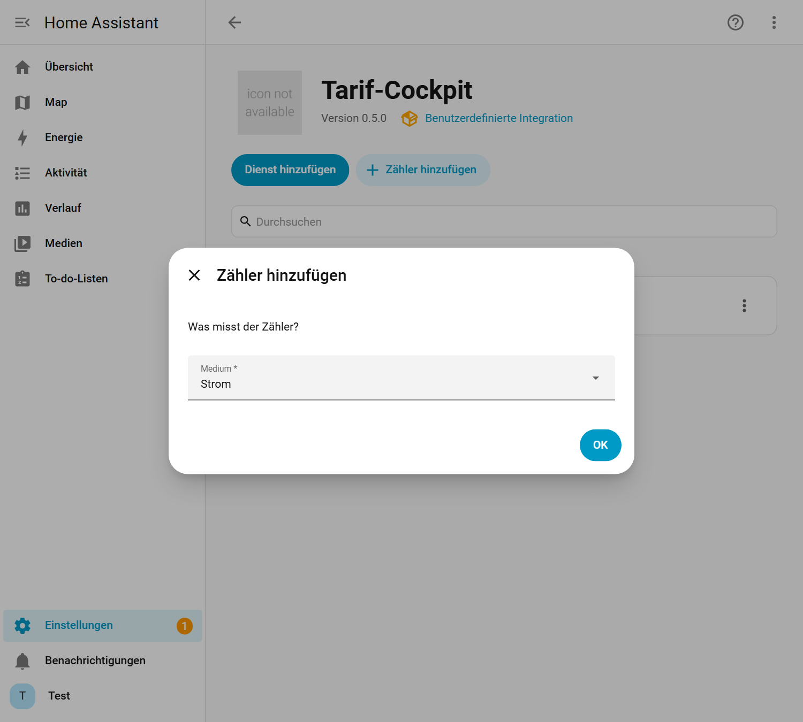
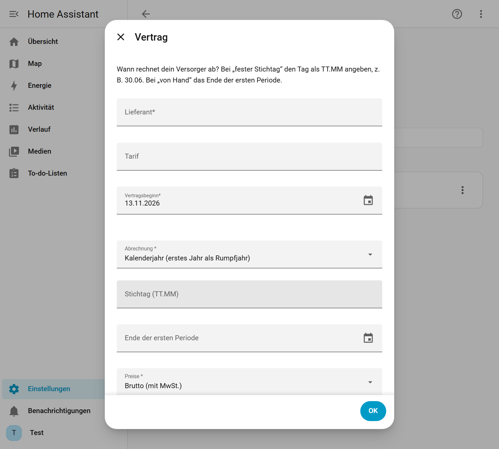

# Tarif-Cockpit

Kosten, Abschläge und Jahresprognose für Strom, Gas und Wasser auf einen Blick: **passt, Nachzahlung oder Rückzahlung**.
Eine Integration für Home Assistant, die Zähler, Verträge, Abrechnungsperioden und Ablesungen verwaltet, dazu zwei Karten im Stil von [energy-cockpit](https://github.com/msucimaker3112/energy-cockpit), auf Deutsch und Englisch.


> **Stand 0.5:** Die Integration hält die Daten (Haushalt, Zähler, Verträge, Perioden, Ablesungen, Tageswerte). Kosten, Prognose und Urteil rechnet sie ab 0.6; bis dahin zeigen die Karten wie bisher die Werte deiner eigenen Sensoren (Sensor-Modus). Umstieg von 0.4: [docs/MIGRATION.md](docs/MIGRATION.md).

## Was du bekommst

| Teil | Inhalt |
|---|---|
| Integration `tarif_cockpit` | Haushalt mit Zählern (Strom, Gas, Wasser, Fernwärme), Vertragskette je Zähler, **Abrechnungsperioden** nach der Regel deines Versorgers (Vertragsjahr, Kalenderjahr mit Rumpfjahr, fester Stichtag, von Hand), Anbieterwechsel mit Schlussperiode, Ablesungen von Hand mit Qualität, Tageswerte aus der Langzeitstatistik oder aus Ablesungen. Daten liegen in einem eigenen Speicher und überstehen Neustarts und Updates. |
| Karte `custom:tarif-cockpit-card` | Je Medium Urteil, Betrag und vier Balken: Kosten bisher, Abschläge bisher (grün), Hochrechnung und Abschläge fürs Jahr, passender Abschlag, Gesamturteil, frei wählbare Kacheln. |
| Karte `custom:tarif-cockpit-analyse-card` | Gas witterungsbereinigt: Kennwert je Gradtag, Vergleich mit der Vorperiode, Verlauf aus der Langzeitstatistik. |


## Installation

Ab Home Assistant 2026.11 heißt HACS **Marketplace** und ist eingebaut (Einstellungen → Marketplace). Tarif-Cockpit braucht Home Assistant 2026.11 oder neuer.

1. **Aus dem Katalog** (sobald Tarif-Cockpit dort gelistet ist): Einstellungen → Marketplace, nach „Tarif-Cockpit“ suchen, herunterladen.
   **Als eigenes Repository** (bis dahin): Einstellungen → Marketplace → Menü oben rechts → **Benutzerdefinierte Repositories**, `https://github.com/HasenbeinMH/tarif-cockpit` eintragen, Kategorie **Integration**, dann „Tarif-Cockpit“ herunterladen. Dafür muss der Marketplace mit GitHub verbunden sein.
2. Home Assistant **neu starten**.
3. Einstellungen → Geräte & Dienste → **Integration hinzufügen** → „Tarif-Cockpit“: Haushalt anlegen.
4. Beim Eintrag „Tarif-Cockpit“ → **Zähler hinzufügen**: Medium, Zählerstand-Sensor (oder „nur Ablesungen“), Einheit, Vertrag mit der Frage „Wann rechnet dein Versorger ab?“ und Startstand. Die Vorschau zeigt die ersten Abrechnungsperioden.
5. Browser-Cache leeren (Strg+F5). Die Karten lädt die Integration selbst, ein Eintrag unter Dashboard-Ressourcen ist nicht nötig.

| Haushalt anlegen | Zähler hinzufügen | Vertrag |
|---|---|---|
|  |  |  |

Mit Home Assistant 2026.10 oder älter heißt der Marketplace noch **HACS**; Tarif-Cockpit ab 0.5 setzt aber 2026.11 voraus. Die Beschriftung der Menüpunkte kann je nach Version leicht abweichen.

## Die Integration (0.5)

**Sensoren je Zähler**
| Sensor | Inhalt |
|---|---|
| Periodenende | Ende der laufenden Abrechnungsperiode. Attribute: `beginn`, `rumpfjahr`, `schlussperiode`, `status`, `regel`, `stichtag`, `lieferant`, `tarif`, `tage_bis_ende` |
| Letzte Ablesung | Zeitpunkt der letzten gültigen Ablesung. Attribute: `stand`, `qualitaet`, `quelle`, `ablesung_id` |
| Zählerstand (abgelesen) | Letzter gültiger abgelesener Stand |
| Tageswerte vollständig | Diagnose: Anteil verwendbarer Tageswerte der letzten 30 Tage |

**Aktionen** (Entwicklerwerkzeuge → Aktionen, oder in Automationen)
| Aktion | Wozu |
|---|---|
| `tarif_cockpit.add_ablesung` | Zählerstand eintragen (`zaehler`, `stand`, optional `zeitpunkt`, `qualitaet`, `notiz`). Mit `ersetzt` wird eine frühere Ablesung korrigiert, ohne sie zu löschen. Antwort: `ablesung_id`. |
| `tarif_cockpit.ablesung_ungueltig` | Ablesung als ungültig markieren; sie bleibt gespeichert. |
| `tarif_cockpit.add_folgevertrag` | Anbieterwechsel: alter Vertrag endet am Vortag (Schlussperiode), neuer Vertrag mit eigener Abrechnungsregel; optional `wechselstand`. Ein Wechsel in eine bereits beendete Periode wird abgelehnt. |
| `tarif_cockpit.set_periodenende` | Der Versorger hat ein paar Tage früher oder später abgelesen: Ende der laufenden oder zuletzt beendeten Periode verschieben (±10 Tage). |
| `tarif_cockpit.add_periode` | Nur bei Abrechnung „von Hand“: nächste Periode anhängen. |
| `tarif_cockpit.recalculate` | Tageswerte neu berechnen (Ablesungen und Verträge bleiben unverändert). |

Beispiel, Ablesung aus einer Automation (z. B. nach einer Telegram-Nachricht):
```yaml
action: tarif_cockpit.add_ablesung
data:
  zaehler: 1a2b3c…          # Gerät „Gas“ des Tarif-Cockpits
  stand: 9812.4
```

**Wichtig:** Fehlende Daten sind „fehlend“, nie 0. Hat ein Zählerstand-Sensor keine Langzeitstatistik (`state_class: total_increasing`), meldet die Integration das unter Einstellungen → Reparaturen. Gespeicherte Daten werden nie still verworfen: Fehlt die Datei oder ist sie beschädigt, startet die Integration nicht mit leeren Daten, sondern meldet sich ebenfalls unter Reparaturen.

Wie Perioden, Rumpfjahr, Anbieterwechsel, Qualitätsstufen und Gradtage genau funktionieren: [docs/DATENMODELL.md](docs/DATENMODELL.md) und [docs/RECHNUNG.md](docs/RECHNUNG.md).

## Die Karten

Die Karten **rechnen in 0.5 noch nicht selbst** (Sensor-Modus). Sie zeigen, was deine Sensoren liefern, und bilden daraus nur das Urteil:
`Differenz = Abschlag × Monate − Hochrechnung`. Positiv heißt Rückzahlung, negativ Nachzahlung. Liegt die Differenz unter 5 % der Abschläge, steht dort „Passt“.
Wie man die Sensoren baut, steht in [docs/SENSOR-MODUS.md](docs/SENSOR-MODUS.md). Ab 0.6 liefert die Integration diese Werte selbst; der Sensor-Modus bleibt als Rückfallebene erhalten.

### Einrichten mit dem Editor

Beim Hinzufügen schlägt die Karte passende Sensoren aus deinem Home Assistant vor. Fehlen sie, steht dort „Noch nicht eingerichtet“, und der Karten-Editor öffnet mit dem **Assistenten**:

| 1. Medien wählen | 2. Sensoren mit Vorschlägen | 3. Zusammenfassung |
|---|---|---|
|  |  |  |

- Je Feld stehen oben die **Vorschläge** (nach Einheit, Geräteklasse und Stichwörtern), darunter alle passenden Entitäten. „Vorschlag übernehmen“ setzt den besten Treffer, darunter steht der Wert der gewählten Entität.
- Schritte für nicht gewählte Medien entfallen.
- Der Reiter **Alle Felder** zeigt das Formular von Home Assistant mit allen Optionen.

### Konfiguration in YAML

#### Tarifübersicht

```yaml
type: custom:tarif-cockpit-card
title: Tarife und Abrechnung
period_start: input_datetime.abrechnung_strom_beginn   # Beginn des Abrechnungszeitraums, in HA änderbar
theme: dunkel          # dunkel, graphit, hell, warm, auto, ha
tolerance_pct: 5       # ab welcher Abweichung nicht mehr "Passt" gilt
strom:
  cost: sensor.kosten_strom_abrechnungsjahr             # Kosten seit Abrechnungsbeginn
  advance_paid: sensor.abschlage_strom_abrechnungsjahr  # bisher gezahlte Abschläge
  forecast_cost: sensor.prognose_strom_kosten           # Hochrechnung bis Jahresende
  forecast_kwh: sensor.prognose_strom_verbrauch         # optional, Hochrechnung in kWh
  advance: input_number.abschlag_strom                  # monatlicher Abschlag
gas:
  cost: sensor.kosten_gas_abrechnungsjahr
  advance_paid: sensor.abschlage_gas_abrechnungsjahr
  forecast_cost: sensor.prognose_gas_kosten
  forecast_kwh: sensor.prognose_gas_verbrauch
  advance: input_number.abschlag_gas
footer:
  - { name: Strombezug, entity: sensor.zahler_strombezug }
  - { name: Letzte Ablesung, entity: input_datetime.zahler_letzte_ablesung, format: date }
  - { name: Strom Arbeitspreis, entity: input_number.tarif_strom_arbeitspreis, scale: 100, unit: ct/kWh, decimals: 2 }
```

Die Entitätsnamen sind Beispiele. Die Karte nimmt jeden Sensor, den du einträgst.

| Option | Bedeutung |
|---|---|
| `strom`, `gas`, `wasser` | Je Medium: `cost`, `advance_paid`, `forecast_cost`, `forecast_kwh` (optional), `advance`. Weitere Felder: `name`, `color` (`#hex`), `months` (Abschläge pro Jahr, Standard 12), `start` (eigener Beginn), `advance_color`, `stale_hint` (Hinweistext) |
| `title`, `subtitle`, `icon` | Kopfzeile |
| `period_start` | Beginn des Abrechnungszeitraums: Datums-Helfer (`input_datetime`, Sensor) oder Text `2026-07-30`. Die Karte zeigt „Abrechnungszeitraum 30.07.2026 – 29.07.2027“. Ist es eine Entität, öffnet ein Tipp darauf den Helfer. Ersetzt `subtitle` |
| `period_end` | Optional, sonst ein Jahr nach dem Beginn minus ein Tag |
| `theme` | Farbschema wie bei energy-cockpit |
| `tolerance_pct` | Schwelle für „Passt“, Standard 5 |
| `advance_color` | Farbe der Abschlagsbalken, Standard grün (`#34d399`, in hellen Schemen dunkler). Auch je Medium möglich |
| `footer` | Liste von Kacheln mit `entity`, `name`, `unit`, `decimals`, `scale`, `format: date` |
| `analysis` | **Veraltet**, weiterhin angezeigt. Bitte die Auswertungskarte verwenden, siehe [docs/MIGRATION.md](docs/MIGRATION.md) |

Fehlt ein Sensor oder ist er nicht verfügbar, zeigt die Kachel „Noch keine Prognose“ bzw. „—“. Nicht eingetragene Zeilen entfallen.

#### Auswertung

```yaml
type: custom:tarif-cockpit-analyse-card
title: Gas witterungsbereinigt
kennwert: sensor.gas_kennwert_je_gradtag          # kWh je Gradtag
kennwert_previous: input_number.gas_kennwert_vorperiode   # optional, für den Vergleich
consumption: sensor.gas_verbrauch_letzte_periode  # kWh
temperature: sensor.gas_aussentemperatur_letzte_periode   # °C
degree_days: sensor.gas_gradtage_letzte_periode
extras:                                           # beliebige weitere Kacheln, z. B. Kaminofen
  - { name: Ofentage seit Ablesung, entity: input_number.ofentage_periode, unit: d, decimals: 0 }
explain: Kennwert = kWh Gas je Gradtag. Bleibt er gleich, hat sich am Heizverhalten nichts geändert.
months: 24          # Monate im Verlauf (höchstens 36)
history: true       # false blendet die Diagramme aus
color: '#fb923c'
theme: dunkel
```

Weitere Optionen: `subtitle`, `icon`, `label` (Überschrift im Panel, Standard „Kennwert“), `pending_text` (Text, solange kein Kennwert vorliegt).

### Farbschemen

| dunkel | hell | warm |
|---|---|---|
|  |  |  |

Dazu `graphit`, `auto` (folgt dem hellen/dunklen Design von Home Assistant) und `ha` (Farben des HA-Themes). Sprache, Zahlenformat und Währung kommen aus Home Assistant.

Weitere Beispiele (Mietwohnung nur Strom, Strom/Gas/Wasser, Nachzahlung, fehlende Prognose) stehen in [docs/BEISPIELE.md](docs/BEISPIELE.md).

## Entwickeln und testen

- Karten: Quellen in `src/`, Build ohne Abhängigkeiten: `node tools/build.mjs` erzeugt `custom_components/tarif_cockpit/frontend/tarif-cockpit.js` (wird mit eingecheckt).
- Rechenkern: `custom_components/tarif_cockpit/engine/`, ohne Home-Assistant-Imports. Tests: `python -m pytest tests/engine`.
- Integration: Tests mit `pytest-homeassistant` in Docker (Python 3.14): `tools/test-ha.ps1` bzw. `tools/test-ha.sh`, mit `min` gegen die kleinste unterstützte HA-Version.
- Übersetzungen der Integration entstehen aus `tools/gen_translations.py`.
- Testseiten: `python -m http.server` im Repo, dann `http://localhost:8000/test/` öffnen. Szenarien und Farbschemen lassen sich oben umschalten.
- Screenshots: `pip install playwright`, `python -m playwright install chromium`, dann `python tools/make-screenshots.py` (schreibt nach `docs/img/`).
- Änderungen: [CHANGELOG.md](CHANGELOG.md).

## Hinweis

Die Karten liefern eine Hochrechnung und ersetzen keine Abrechnung deines Versorgers.

## Lizenz

MIT, siehe [LICENSE](LICENSE). Editor-Baukasten, Assistent und Build-Aufbau sind nach [energy-cockpit](https://github.com/msucimaker3112/energy-cockpit) entstanden (MIT License, Copyright (c) 2026 Musicmaker3112).
