# Tarif-Cockpit

Kosten, Abschläge und Jahresprognose für Strom, Gas und Wasser auf einen Blick: **passt, Nachzahlung oder Rückzahlung**.
Eine Integration für Home Assistant, die Zähler, Verträge, Abrechnungsperioden und Ablesungen verwaltet, dazu zwei Karten im Stil von [energy-cockpit](https://github.com/msucimaker3112/energy-cockpit), auf Deutsch und Englisch.

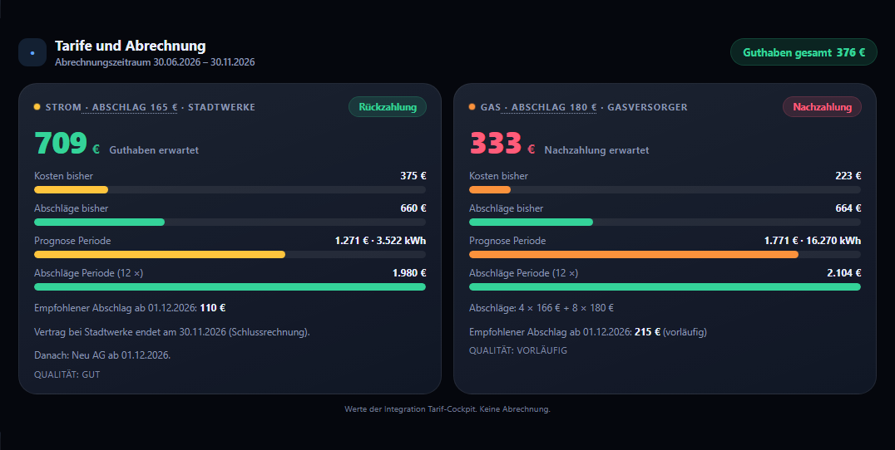

> **Stand 1.0:** Wettervorhersage und Mehrjahresmittel für die Rest-Gradtage, Band „kalter/milder Rest-Winter“, **Archiv** jeder beendeten Periode mit **Prognose gegen Realität**, Event bei Urteilswechsel, **Kündigungsfrist** mit Erinnerung, Aktion zur **Übernahme aus 0.3**, vollständige Diagnose. Beispiele für Benachrichtigungen: [docs/AUTOMATIONEN.md](docs/AUTOMATIONEN.md).
>
> **Seit 0.9:** Impulszähler (Impulskonstante, Zählerneustarts), Abgleich jedes Zähler-Sensors mit den Ablesungen (die Ablesung gilt, Tageswerte werden angeglichen, Hinweis ab 2 %), Gasleistung, Brennerlaufzeit, Brennerstarts und Takten bei Gas mit Impulsen.
>
> **Seit 0.8:** Wärmeerzeuger (Gastherme, Wärmepumpe, Split-Klima, Fernwärme, Kaminofen) mit getrennter eingesetzter Energie, Wärme und Entlastung; Kaminofen und Split-Klima entlasten die Gasprognose, sobald es genug Vergleichstage gibt; Heizen am Haushaltsstrom wird vor der Strom-Grundlast abgezogen; temperaturbereinigter Kennwert; Auswertungskarte mit Streudiagramm und Kostenverlauf. Details: [CHANGELOG.md](CHANGELOG.md).
>
> **Seit 0.7:** Einrichtung komplett in der Oberfläche, ohne YAML: ein paar Fragen zum Haushalt, Zähler mit Vertrag, Preisen und Abschlägen, die Karte im Editor wählen, fertig. Die Karte zeigt die Werte der Integration (Urteil, Saldo, Prognose mit Qualität, Abschlagsstufen, empfohlener Abschlag), ein Tipp auf den Abschlag ändert ihn. Schritt für Schritt mit Bildern: [docs/EINRICHTUNG.md](docs/EINRICHTUNG.md). Umstieg: [docs/MIGRATION.md](docs/MIGRATION.md).

## Was du bekommst

| Teil | Inhalt |
|---|---|
| Integration `tarif_cockpit` | Haushalt mit Zählern (Strom, Gas, Wasser, Fernwärme), Vertragskette je Zähler, **Abrechnungsperioden** nach der Regel deines Versorgers (Vertragsjahr, Kalenderjahr mit Rumpfjahr, fester Stichtag, von Hand), Anbieterwechsel mit Schlussperiode, Ablesungen mit Qualität, Tageswerte. **Rechnet** Kosten (Preise mit Gültigkeit, brutto/netto, Abwasser), Abschläge und Zahlungen, die Prognose (Strom und Wasser über das Vorjahr, Gas und Fernwärme über einen gelernten Kennwert je Gradtag, Wallbox getrennt) und das Ergebnis mit Qualitätsangabe. Daten liegen in einem eigenen Speicher und überstehen Neustarts und Updates. |
| Karte `custom:tarif-cockpit-card` | Je Zähler Urteil, Saldo und vier Balken: Kosten bisher, Abschläge bisher (grün), Prognose und Abschläge der Periode, Abschlagsstufen, empfohlener Abschlag, Prognose-Qualität, Anbieterwechsel; Gesamturteil. Abschlag per Tipp ändern. |
| Wärmeerzeuger (optional) | Gastherme, Wärmepumpe, Split-Klima, Fernwärme, Kaminofen, Elektroheizung: eingesetzte Energie, Wärme, Entlastung, Betriebsstunden; Kaminofen mit Holz und Holzkosten (geschätzt). |
| Karte `custom:tarif-cockpit-analyse-card` | Heizung: gelernter Kennwert je Gradtag, Warmwasser-Grundlast, temperaturbereinigter Kennwert, Streudiagramm Verbrauch über Gradtage, Kostenverlauf gegen die Abschläge, Wärmeerzeuger. |

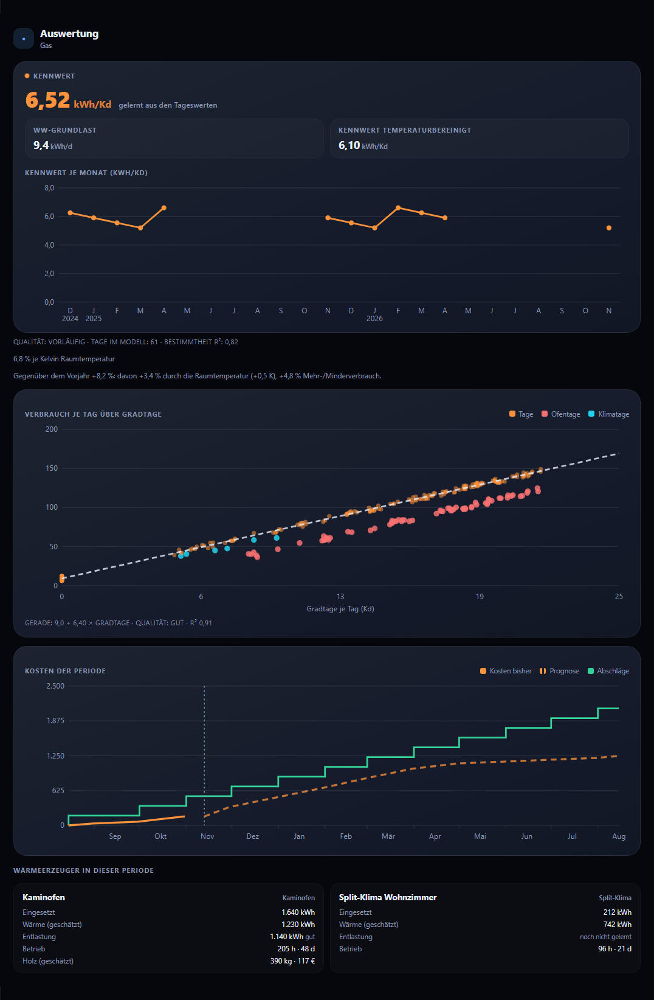

## Was unterstützt wird

| Thema | Varianten |
|---|---|
| Heizung | Gas, Fernwärme, Wärmepumpe (eigener Zähler oder am Hausstrom), Split-Klima, Elektroheizung, Kaminofen und Kombinationen |
| Warmwasser | über die Heizung, Durchlauferhitzer oder Boiler (Strom), Wärmepumpe, Solarthermie (nur Hinweis) |
| Strom | Festpreis, mit oder ohne PV und Speicher, Wallbox getrennt, § 14a als fester Rabatt |
| Abrechnung | 12 oder 11 Abschläge, monatlich, zweimonatlich oder vierteljährlich, Rumpfjahr, Anbieterwechsel, Preiswechsel, Bonus und Gutschrift, Mindestlaufzeit und Kündigungsfrist |
| Fernwärme | Arbeitspreis (kWh oder MWh), Grundpreis, Leistungspreis, Messpreis |
| Wasser | Frisch- und Abwasser mit eigenen Preisen, Grundgebühren, Gartenwasser-Abzug, Niederschlagswasser als fester Betrag |
| Daten | Zählerstand-Sensor, Impulszähler, nur Ablesungen von Hand |
| Noch nicht | Öl und Pellets (Lieferungen), HT/NT, dynamischer Tarif, § 14a zeitvariabel, Mieter mit Heizkostenverteiler |

Fehlt etwas, gibt es eine Rückfallebene statt einer falschen Zahl: ohne Vorjahr der Jahresverbrauch laut Rechnung, ohne Sensor die Ablesungen, ohne belastbaren Kennwert keine Wärmeprognose (fehlend ist nie 0).

## Installation

Ab Home Assistant 2026.11 heißt HACS **Marketplace** und ist eingebaut (Einstellungen → Marketplace). Tarif-Cockpit braucht Home Assistant 2026.11 oder neuer.

1. **Aus dem Katalog** (sobald Tarif-Cockpit dort gelistet ist): Einstellungen → Marketplace, nach „Tarif-Cockpit“ suchen, herunterladen.
   **Als eigenes Repository** (bis dahin): Einstellungen → Marketplace → Menü oben rechts → **Benutzerdefinierte Repositories**, `https://github.com/HasenbeinMH/tarif-cockpit` eintragen, Kategorie **Integration**, dann „Tarif-Cockpit“ herunterladen. Dafür muss der Marketplace mit GitHub verbunden sein.
2. Home Assistant **neu starten**.
3. Einstellungen → Geräte & Dienste → **Integration hinzufügen** → „Tarif-Cockpit“: ein paar Fragen zum Haushalt (Womit heizt du? Warmwasser? PV, Speicher, Wallbox? Eigentümer oder Mieter? Wie oft Abschläge?). Die Antworten steuern die folgenden Schritte.
4. Beim Eintrag „Tarif-Cockpit“ → **Zähler hinzufügen**: Medium, Zählerstand-Sensor (oder „nur Ablesungen“), Einheit, Vertrag mit der Frage „Wann rechnet dein Versorger ab?“, Preise, Abschläge, Startstand. Am Ende eine **Zusammenfassung** mit den ersten Perioden und einer ersten Prognose. Eine Wallbox oder ein Gartenwasserzähler wird als Unterzähler eines Hauptzählers angelegt.
5. Dashboard bearbeiten → **Karte hinzufügen** → „Tarif-Cockpit“. Der Editor öffnet mit dem Reiter **Integration**: Zähler wählen, fertig.
6. Nach einem Update Browser-Cache leeren (Strg+F5). Die Karten lädt die Integration selbst, ein Eintrag unter Dashboard-Ressourcen ist nicht nötig.

| Fragen zum Haushalt | Zusammenfassung des Zählers | Karte im Editor |
|---|---|---|
|  |  |  |

Alle Schritte mit Bildern: [docs/EINRICHTUNG.md](docs/EINRICHTUNG.md). Später ändern: am Zähler **Neu konfigurieren** → Stammdaten, Anbieter wechseln, Preis ändern, Abschlag ändern; am Haushalt **Konfigurieren** für Situation, Klima und Toleranz.

Mit Home Assistant 2026.10 oder älter heißt der Marketplace noch **HACS**; Tarif-Cockpit ab 0.5 setzt aber 2026.11 voraus. Die Beschriftung der Menüpunkte kann je nach Version leicht abweichen.

## Die Integration

**Sensoren je Zähler** (Beispiel-IDs für einen Zähler „Strom“: `sensor.strom_kosten_bisher`, `sensor.strom_abschlage_bisher`, `sensor.strom_prognose_kosten` usw.)
| Sensor | Inhalt |
|---|---|
| Kosten bisher | Arbeits-, Grund- und Messpreis (bei Wasser auch Abwasser) seit Periodenbeginn, tagesgenau je Preisabschnitt |
| Abschläge bisher / Abschläge Periode | fällige bzw. alle Abschläge der Periode, mit Einmalzahlungen und Gutschriften |
| Abschlag | aktueller Abschlag je Zahltag (Attribut `anzahl_je_periode`) |
| Prognose Verbrauch / Prognose Kosten | bis zum Ende der laufenden Periode; Attribute: Methode, Qualität, Vorjahreswerte bzw. Gradtage; bei Wärme `quelle` (vorhersage, mittel, vorjahr), `vorhersage_tage`, `rest_kalt`/`rest_warm`; Prognose Kosten mit `kalt`/`warm` |
| Saldo, Urteil | Saldo = Abschläge der Periode − Prognose Kosten; Urteil `passt`, `rueckzahlung` oder `nachzahlung` (Toleranz des Haushalts); Saldo mit `saldo_kalt`/`saldo_warm`, wenn es mindestens zwei Vorjahre gibt |
| Abschlag empfohlen | ab dem nächsten Zahltag, damit die Periode ausgeglichen endet; Attribut `vorlaeufig` je nach Prognose-Qualität |
| Prognose-Qualität | `annahme`, `unzureichend`, `vorlaeufig`, `gut`, `sehr_gut` (Diagnose) |
| Kennwert, Warmwasser-Grundlast | nur Gas und Fernwärme: gelernter Kennwert (kWh je Gradtag) mit R², Anzahl Tage, Temperaturspanne |
| Kennwert temperaturbereinigt | Gas/Fernwärme: Kennwert mit Gradtagen aus der gemessenen Innentemperatur; Attribute `prozent_je_kelvin` (gelernt oder 6 %/K als Annahme), `vorjahr` (Aufteilung Raumtemperatur/Mehrverbrauch) |
| Saldo gesamt | am Gerät „Haushalt“: Summe über alle Zähler; leer, solange ein Zähler noch keinen Saldo hat (Attribut `ohne_prognose`) |
| Periodenende | Ende der laufenden Abrechnungsperiode. Attribute: `beginn`, `rumpfjahr`, `schlussperiode`, `status`, `regel`, `stichtag`, `lieferant`, `tarif`, `tage_bis_ende`, `kuendigung_bis`, `tage_bis_kuendigung`, `kuendigung_hinweis`, `vertragsende`, `kuendigung` (`termin`, `nach_mindestlaufzeit`, `keine_angaben`) |
| Letzte Ablesung | Zeitpunkt der letzten gültigen Ablesung. Attribute: `stand`, `qualitaet`, `quelle`, `ablesung_id` |
| Zählerstand (abgelesen) | Letzter gültiger abgelesener Stand |
| Tageswerte vollständig | Diagnose: Anteil verwendbarer Tageswerte der letzten 30 Tage |
| Abgleich mit Ablesung | Diagnose, Zähler mit Sensor: Abweichung des Sensors von der abgelesenen Menge im letzten Intervall (%); Attribute `faktor`, `fehlende_menge`, `angeglichen`, `offset`, `intervalle` |
| Gasleistung, Brennerlaufzeit, Brennerstarts | Gas mit Impulszähler: Momentanleistung (kW); Laufzeit und Starts der Periode, Attribute `taktet_gestern`, `taktet_tage` |

**Sensoren je Wärmeerzeuger** (eigenes Gerät, Werte der laufenden Periode bis gestern)
| Sensor | Inhalt |
|---|---|
| Eingesetzte Energie | Gas, Strom oder Holz in kWh; Attribut `messqualitaet` (real, estimated, assumption) |
| Wärme | gemessen (Wärmemengenzähler) oder geschätzt (Attribut `geschaetzt`) |
| Entlastung | kWh, die der Gas-/Fernwärmezähler dadurch weniger braucht; leer, bis sie gelernt ist (Kaminofen vorher als Annahme, Attribut `qualitaet`) |
| Betriebsstunden, Betriebstage | aus der Betriebszustand-Entität bzw. beim Kaminofen aus dem Temperaturanstieg; ein Tag zählt ab 1 h |
| Holz (geschätzt), Holzkosten (geschätzt) | nur Kaminofen |

**Aktionen** (Entwicklerwerkzeuge → Aktionen, oder in Automationen). Alle Aktionen ändern Daten und dürfen deshalb nur von Administratoren aufgerufen werden; Automationen und Skripte sind davon nicht betroffen.
| Aktion | Wozu |
|---|---|
| `tarif_cockpit.add_ablesung` | Zählerstand eintragen (`zaehler`, `stand`, optional `zeitpunkt`, `qualitaet`, `notiz`). Mit `ersetzt` wird eine frühere Ablesung korrigiert, ohne sie zu löschen. Antwort: `ablesung_id`. |
| `tarif_cockpit.ablesung_ungueltig` | Ablesung als ungültig markieren; sie bleibt gespeichert. |
| `tarif_cockpit.add_folgevertrag` | Anbieterwechsel: alter Vertrag endet am Vortag (Schlussperiode), neuer Vertrag mit eigener Abrechnungsregel; optional `wechselstand`, `mindestlaufzeit` (Monate), `kuendigungsfrist` (Wochen). Ein Wechsel in eine bereits beendete Periode wird abgelehnt. |
| `tarif_cockpit.set_periodenende` | Der Versorger hat ein paar Tage früher oder später abgelesen: Ende der laufenden oder zuletzt beendeten Periode verschieben (±10 Tage). |
| `tarif_cockpit.add_periode` | Nur bei Abrechnung „von Hand“: nächste Periode anhängen. |
| `tarif_cockpit.set_preis` | Preisänderung ab einem Datum (Arbeits-, Grund-, Messpreis, Brennwert/Zustandszahl, Abwasser, feste Jahresbeträge, Fernwärme-Leistungspreis). Die Verbrauchsprognose bleibt unverändert. |
| `tarif_cockpit.set_abschlag` | Neuer Abschlag ab einem Datum, optional Zahltag, Rhythmus (1/2/3 Monate) und Anzahl je Periode (z. B. 11). |
| `tarif_cockpit.add_zahlung` | Zahlung erfassen: Abschlag (ersetzt den geplanten im selben Monat), Einmalzahlung, Gutschrift, Schlusszahlung, Erstattung; bezahlt, geplant oder storniert. |
| `tarif_cockpit.add_rechnung` | Rechnung des Versorgers erfassen (getrennt von Zahlungen), auch als Korrektur einer früheren Rechnung. |
| `tarif_cockpit.recalculate` | Tageswerte neu berechnen (Ablesungen und Verträge bleiben unverändert). |
| `tarif_cockpit.uebernahme_v03` | Umstieg von der Template-Version 0.3: liest deine Helfer (Abschlag, Zahltag, Arbeits- und Grundpreis, Startstand, Abrechnungsbeginn, Brennwert, Zustandszahl) und trägt sie beim Zähler ein. Antwort: übernommene und übersprungene Werte mit Grund. Anleitung: [docs/MIGRATION.md](docs/MIGRATION.md#von-03-template-sensoren-auf-10). |

**Events** (für Automationen; den Versand, z. B. per Telegram, machst du selbst, Beispiele in [docs/AUTOMATIONEN.md](docs/AUTOMATIONEN.md))
| Event | Wann | Daten |
|---|---|---|
| `tarif_cockpit_urteil_geaendert` | das Urteil eines Zählers wechselt innerhalb derselben Periode (nicht beim Start) | `zaehler`, `device_id`, `name`, `alt`, `neu`, `saldo`, `prognose_kosten`, `qualitaet`, `abschlag_empfohlen` |
| `tarif_cockpit_kuendigungsfrist` | 28 Tage vor dem letzten Kündigungstag und an diesem Tag, je Frist nur einmal | `zaehler`, `device_id`, `name`, `lieferant`, `kuendigen_bis`, `vertragsende`, `tage` |

Ab 28 Tagen vor dem letzten Kündigungstag steht zusätzlich ein Hinweis unter Einstellungen → Reparaturen. Mindestlaufzeit und Kündigungsfrist trägst du im Vertragsschritt ein oder später am Zähler unter **Neu konfigurieren → Vertrag ändern**.

**Archiv:** Endet eine Periode, friert die Integration Kosten, Menge, Zahlungen, Saldo, Urteil, Preise und alle Prognose-Schnappschüsse ein (vorläufig). Endgültig abgeschlossen ist sie mit einer echten Ablesung am Periodenende oder kurz danach bzw. mit einer Rechnung, frühestens 11 Tage nach dem Ende (bis dahin lässt sich das Ende mit `set_periodenende` noch verschieben), spätestens 60 Tage nach dem Ende; danach ändert sie sich nie mehr. Die Auswertungskarte zeigt daraus „Prognose gegen Realität“.

**Diagnose:** Einstellungen → Geräte & Dienste → Tarif-Cockpit → Menü → **Diagnose herunterladen**. Entitäts-IDs, Namen, Lieferanten und Notizen sind geschwärzt; die Datei kann einem Fehlerbericht beigelegt werden.

Beispiel, Ablesung aus einer Automation (z. B. nach einer Telegram-Nachricht):
```yaml
action: tarif_cockpit.add_ablesung
data:
  zaehler: 1a2b3c…          # Gerät „Gas“ des Tarif-Cockpits
  stand: 9812.4
```

**Was du je Datenstufe bekommst**
| Datenstufe | Quelle | Was dazukommt |
|---|---|---|
| 1 | Ablesungen von Hand (`add_ablesung`) | Kosten, Abschläge, Prognose, Kennwert je Ableseperiode |
| 2 | Zählerstand-Sensor oder Impulszähler | Tageswerte, Tagesregression, Ofen- und Klima-Effekt, Abgleich mit den Ablesungen; bei Gas mit Impulsen Leistung, Brennerlaufzeit, Starts, Takten |

**Prognose ohne belastbare Daten:** Bei Gas und Fernwärme gibt es erst eine Prognose, wenn der Kennwert aus deinen eigenen Daten mindestens „vorläufig“ ist (genug Tage oder Ableseperioden, mindestens 5 K Temperaturspanne, R² ≥ 0,6). Eine Annahme wird nicht verwendet. Bei Strom und Wasser gilt: Vorjahr im gleichen Kalenderfenster, sonst der Durchschnitt seit Periodenbeginn (ab 30 Tagen, „vorläufig“), sonst der Jahresverbrauch laut letzter Rechnung („Annahme“). Hat ein Zählerstand-Sensor noch keine Jahreshistorie, kannst du beim Zähler eine **Ersatzquelle für fehlende Historie** eintragen (z. B. den Bezugszähler des Wechselrichters).

**Wichtig:** Fehlende Daten sind „fehlend“, nie 0. Hat ein Zählerstand-Sensor keine Langzeitstatistik (`state_class: total_increasing`), meldet die Integration das unter Einstellungen → Reparaturen. Gespeicherte Daten werden nie still verworfen: Fehlt die Datei oder ist sie beschädigt, startet die Integration nicht mit leeren Daten, sondern meldet sich ebenfalls unter Reparaturen.

Wie Perioden, Rumpfjahr, Anbieterwechsel, Qualitätsstufen und Gradtage genau funktionieren: [docs/DATENMODELL.md](docs/DATENMODELL.md) und [docs/RECHNUNG.md](docs/RECHNUNG.md).

## Die Karten

### Mit der Integration (ab 0.7)

```yaml
type: custom:tarif-cockpit-card
integration: true
```

| Option | Bedeutung |
|---|---|
| `integration` | `true`: Werte aus der Integration (ohne: Sensor-Modus, siehe unten) |
| `zaehler` | optional: Liste der Geräte-IDs der Zähler; ohne Angabe alle Hauptzähler. Den Gesamtsaldo zeigt die Karte nur, wenn alle Hauptzähler zu sehen sind |
| `title`, `icon` | Kopfzeile |
| `theme` | Farbschema (`dunkel`, `graphit`, `hell`, `warm`, `auto`, `ha`) |
| `colors` | Farbe je Medium, z. B. `{strom: '#ffc53d', gas: '#fb923c'}` |
| `advance_color` | Farbe der Abschlagsbalken |
| `footer` | Kacheln wie im Sensor-Modus |

Die Felder des Sensor-Modus (`strom:`, `gas:`, `period_start`, `tolerance_pct` …) werden im Integrations-Modus nicht verwendet; Periode und Toleranz kommen aus der Integration.

Die Karte rechnet nichts selbst. Sie holt über die Integration, welche Sensoren zu welchem Zähler gehören, und zeigt deren Werte:

- **Urteil und Saldo** aus den Sensoren „Urteil“ und „Saldo“, das Gesamturteil aus „Saldo gesamt“ (leer, solange ein Zähler noch keine Prognose hat).
- **Balken:** Kosten bisher, Abschläge bisher, Prognose der Periode, Abschläge der Periode.
- **Abschlagsstufen als Text**, z. B. „4 × 166 € + 8 × 180 €“, und der **empfohlene Abschlag** ab dem nächsten Zahltag, bei Qualität unter „gut“ mit „vorläufig“.
- **Prognose-Qualität** als Etikett; solange es keine Prognose gibt, steht der Grund da (z. B. „Kennwert wird noch gelernt“).
- **Anbieterwechsel** in der laufenden Periode: alter Vertrag bis zum Wechsel (Schlussrechnung), danach der neue.
- **Band** bei Wärme: Saldo, wenn der Rest so kalt wie im kältesten bzw. so mild wie im wärmsten Vorjahr wird (ab zwei Vorjahren).
- **Kündigungsfrist**, sobald sie näher als sechs Wochen ist.
- Ein **Tipp auf den Abschlag** öffnet einen Dialog: Betrag und „Gültig ab“, dann `tarif_cockpit.set_abschlag`. Nur für Administratoren; andere Benutzer sehen den Abschlag ohne Dialog.

| Kennwert wird noch gelernt | Abschlag ändern |
|---|---|
| 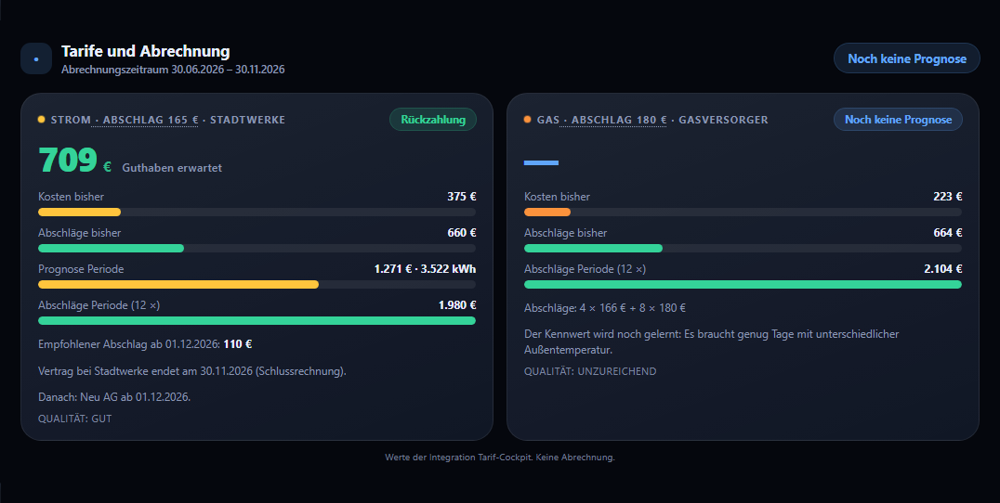 |  |

| Band und Kündigungsfrist | Prognose gegen Realität |
|---|---|
| 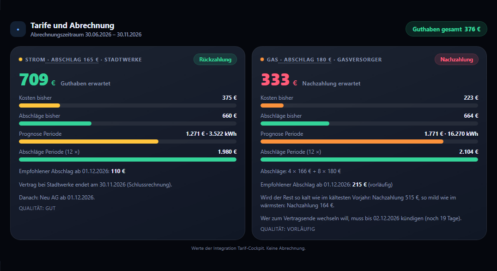 | 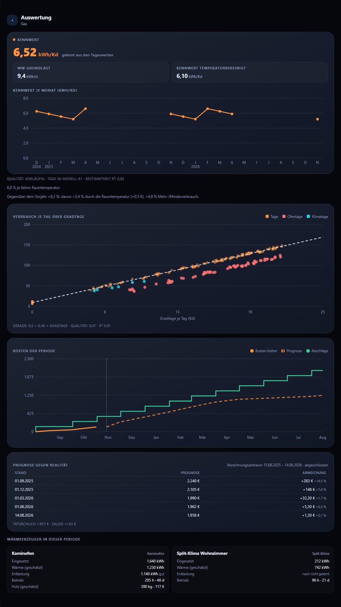 |

Die Auswertungskarte geht genauso (`type: custom:tarif-cockpit-analyse-card`, `integration: true`, optional `zaehler: [Gerät des Gas- oder Fernwärmezählers]`; ohne diese der Stromzähler einer Wärmepumpe): gelernter Kennwert, Warmwasser-Grundlast (nur wenn Warmwasser über die Heizung läuft), temperaturbereinigter Kennwert, Qualität mit Anzahl Tage und R², Verlauf des Kennwerts, **Streudiagramm** Verbrauch über Gradtage mit Regressionsgerade (Ofen- und Klimatage farbig), **Kostenverlauf** der Periode (Ist, Prognose, Abschlags-Treppe) und je Wärmeerzeuger Eingang, Wärme, Entlastung. Dazu die Tabelle **Prognose gegen Realität** der zuletzt beendeten Periode (je Schnappschuss Prognose und Abweichung zu den tatsächlichen Kosten, vorläufig oder abgeschlossen). `diagramme: false`, `erzeuger: false` bzw. `archiv: false` blenden Diagramme, Erzeuger bzw. die Tabelle aus. Beispiele: [docs/BEISPIELE.md](docs/BEISPIELE.md).

### Sensor-Modus (ohne Integration)

Ohne `integration: true` zeigen die Karten die Sensoren an, die du einträgst, und bilden daraus nur das Urteil:
`Differenz = Abschlag × Monate − Hochrechnung`. Alte Konfigurationen bleiben gültig. Mit den Sensoren der Integration sähe das so aus (Zähler „Strom“ und „Gas“, deutsche Oberfläche); einfacher ist `integration: true`:

```yaml
type: custom:tarif-cockpit-card
strom:
  cost: sensor.strom_kosten_bisher
  advance_paid: sensor.strom_abschlage_bisher
  forecast_cost: sensor.strom_prognose_kosten
  forecast_kwh: sensor.strom_prognose_verbrauch
  advance: sensor.strom_abschlag
  months: 12            # Abschläge je Periode (Attribut anzahl_je_periode des Sensors „Abschlag“)
gas:
  cost: sensor.gas_kosten_bisher
  advance_paid: sensor.gas_abschlage_bisher
  forecast_cost: sensor.gas_prognose_kosten
  forecast_kwh: sensor.gas_prognose_verbrauch
  advance: sensor.gas_abschlag
  months: 12
```

Die Entitäts-IDs bildet Home Assistant aus Zählername und Sensorname (Umlaute ohne Punkte, z. B. `sensor.strom_abschlage_bisher`); unter Einstellungen → Geräte & Dienste → Tarif-Cockpit stehen die genauen IDs. Im Sensor-Modus bildet die Karte ihr Urteil aus „Abschlag × Anzahl“; bei Abschlagsstufen kann es vom Sensor „Urteil“ abweichen, maßgeblich ist der Sensor. Ganz ohne Integration funktioniert die Karte mit eigenen Template-Sensoren, siehe [docs/SENSOR-MODUS.md](docs/SENSOR-MODUS.md).

### Sensor-Modus mit dem Editor

Ist die Integration nicht eingerichtet, schlägt die Karte beim Hinzufügen passende Sensoren aus deinem Home Assistant vor. Fehlen sie, steht dort „Noch nicht eingerichtet“, und der Karten-Editor öffnet mit dem **Assistenten** (mit Integration gibt es zusätzlich den Reiter „Integration“, der Knopf „Sensor-Modus verwenden“ wechselt zurück):

| 1. Medien wählen | 2. Sensoren mit Vorschlägen | 3. Zusammenfassung |
|---|---|---|
| 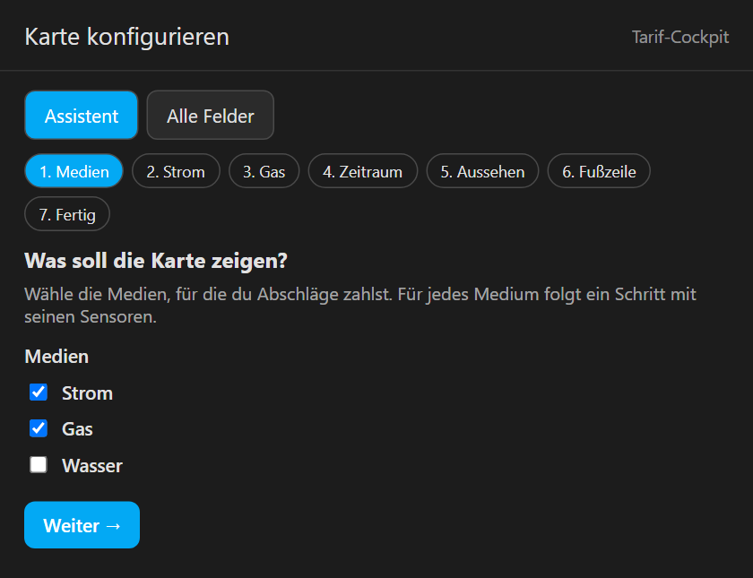 | 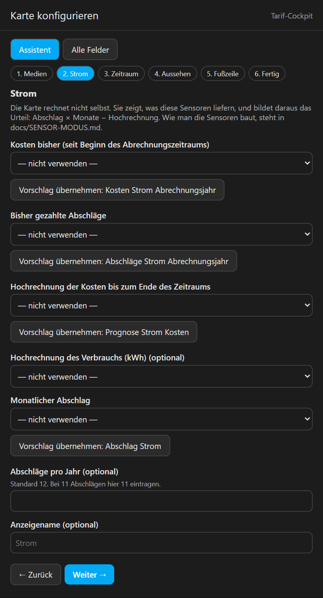 | 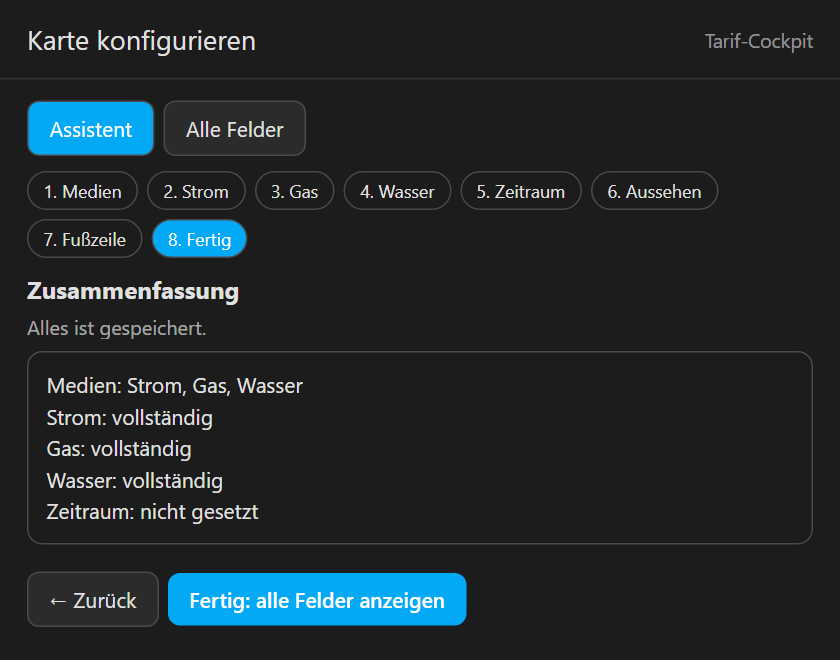 |

- Je Feld stehen oben die **Vorschläge** (nach Einheit, Geräteklasse und Stichwörtern), darunter alle passenden Entitäten. „Vorschlag übernehmen“ setzt den besten Treffer, darunter steht der Wert der gewählten Entität.
- Schritte für nicht gewählte Medien entfallen.
- Der Reiter **Alle Felder** zeigt das Formular von Home Assistant mit allen Optionen.

### Konfiguration in YAML

#### Tarifübersicht

```yaml
type: custom:tarif-cockpit-card
title: Tarife und Abrechnung
period_start: input_datetime.abrechnung_strom_beginn   # Beginn des Abrechnungszeitraums, in HA änderbar
theme: dunkel          # dunkel, graphit, hell, warm, auto, ha
tolerance_pct: 5       # ab welcher Abweichung nicht mehr "Passt" gilt
strom:
  cost: sensor.kosten_strom_abrechnungsjahr             # Kosten seit Abrechnungsbeginn
  advance_paid: sensor.abschlage_strom_abrechnungsjahr  # bisher gezahlte Abschläge
  forecast_cost: sensor.prognose_strom_kosten           # Hochrechnung bis Jahresende
  forecast_kwh: sensor.prognose_strom_verbrauch         # optional, Hochrechnung in kWh
  advance: input_number.abschlag_strom                  # monatlicher Abschlag
gas:
  cost: sensor.kosten_gas_abrechnungsjahr
  advance_paid: sensor.abschlage_gas_abrechnungsjahr
  forecast_cost: sensor.prognose_gas_kosten
  forecast_kwh: sensor.prognose_gas_verbrauch
  advance: input_number.abschlag_gas
footer:
  - { name: Strombezug, entity: sensor.zahler_strombezug }
  - { name: Letzte Ablesung, entity: input_datetime.zahler_letzte_ablesung, format: date }
  - { name: Strom Arbeitspreis, entity: input_number.tarif_strom_arbeitspreis, scale: 100, unit: ct/kWh, decimals: 2 }
```

Die Entitätsnamen sind Beispiele. Die Karte nimmt jeden Sensor, den du einträgst.

| Option | Bedeutung |
|---|---|
| `strom`, `gas`, `wasser` | Je Medium: `cost`, `advance_paid`, `forecast_cost`, `forecast_kwh` (optional), `advance`. Weitere Felder: `name`, `color` (`#hex`), `months` (Abschläge pro Jahr, Standard 12), `start` (eigener Beginn), `advance_color`, `stale_hint` (Hinweistext) |
| `title`, `subtitle`, `icon` | Kopfzeile |
| `period_start` | Beginn des Abrechnungszeitraums: Datums-Helfer (`input_datetime`, Sensor) oder Text `2026-07-30`. Die Karte zeigt „Abrechnungszeitraum 30.07.2026 – 29.07.2027“. Ist es eine Entität, öffnet ein Tipp darauf den Helfer. Ersetzt `subtitle` |
| `period_end` | Optional, sonst ein Jahr nach dem Beginn minus ein Tag |
| `theme` | Farbschema wie bei energy-cockpit |
| `tolerance_pct` | Schwelle für „Passt“, Standard 5 |
| `advance_color` | Farbe der Abschlagsbalken, Standard grün (`#34d399`, in hellen Schemen dunkler). Auch je Medium möglich |
| `footer` | Liste von Kacheln mit `entity`, `name`, `unit`, `decimals`, `scale`, `format: date` |
| `analysis` | **Veraltet**, weiterhin angezeigt. Bitte die Auswertungskarte verwenden, siehe [docs/MIGRATION.md](docs/MIGRATION.md) |

Fehlt ein Sensor oder ist er nicht verfügbar, zeigt die Kachel „Noch keine Prognose“ bzw. „—“. Nicht eingetragene Zeilen entfallen.

#### Auswertung

```yaml
type: custom:tarif-cockpit-analyse-card
title: Gas witterungsbereinigt
kennwert: sensor.gas_kennwert_je_gradtag          # kWh je Gradtag
kennwert_previous: input_number.gas_kennwert_vorperiode   # optional, für den Vergleich
consumption: sensor.gas_verbrauch_letzte_periode  # kWh
temperature: sensor.gas_aussentemperatur_letzte_periode   # °C
degree_days: sensor.gas_gradtage_letzte_periode
extras:                                           # beliebige weitere Kacheln, z. B. Kaminofen
  - { name: Ofentage seit Ablesung, entity: input_number.ofentage_periode, unit: d, decimals: 0 }
explain: Kennwert = kWh Gas je Gradtag. Bleibt er gleich, hat sich am Heizverhalten nichts geändert.
months: 24          # Monate im Verlauf (höchstens 36)
history: true       # false blendet die Diagramme aus
color: '#fb923c'
theme: dunkel
```

Weitere Optionen: `subtitle`, `icon`, `label` (Überschrift im Panel, Standard „Kennwert“), `pending_text` (Text, solange kein Kennwert vorliegt).

### Farbschemen

| dunkel | hell | warm |
|---|---|---|
| 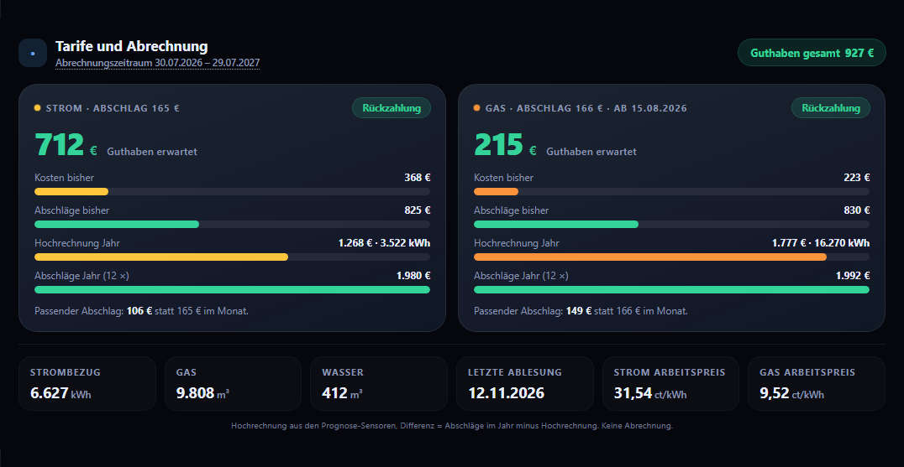 | 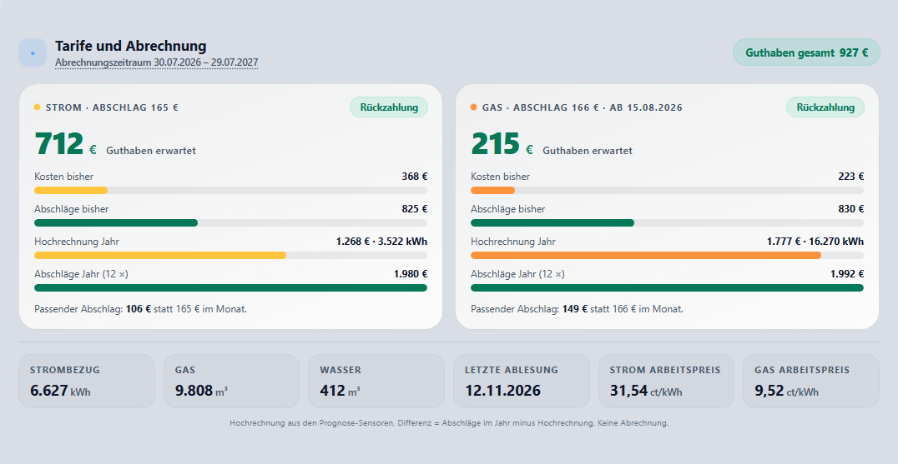 | 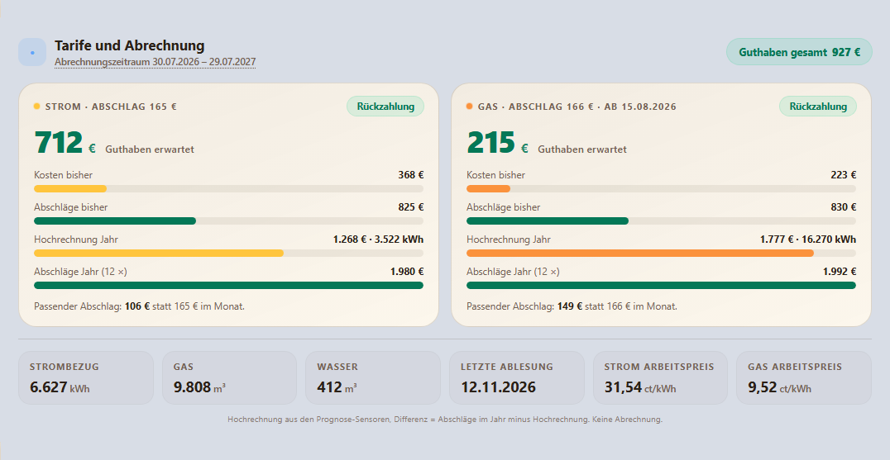 |

Dazu `graphit`, `auto` (folgt dem hellen/dunklen Design von Home Assistant) und `ha` (Farben des HA-Themes). Sprache, Zahlenformat und Währung kommen aus Home Assistant.

Weitere Beispiele (Mietwohnung nur Strom, Strom/Gas/Wasser, Nachzahlung, fehlende Prognose) stehen in [docs/BEISPIELE.md](docs/BEISPIELE.md).

## Entwickeln und testen

- Karten: Quellen in `src/`, Build ohne Abhängigkeiten: `node tools/build.mjs` erzeugt `custom_components/tarif_cockpit/frontend/tarif-cockpit.js` (wird mit eingecheckt).
- Rechenkern: `custom_components/tarif_cockpit/engine/`, ohne Home-Assistant-Imports. Tests: `python -m pytest tests/engine`.
- Integration: Tests mit `pytest-homeassistant` in Docker (Python 3.14): `tools/test-ha.ps1` bzw. `tools/test-ha.sh`, mit `min` gegen die kleinste unterstützte HA-Version.
- Übersetzungen der Integration entstehen aus `tools/gen_translations.py`.
- Testseiten: `python -m http.server` im Repo, dann `http://localhost:8000/test/` öffnen. Szenarien und Farbschemen lassen sich oben umschalten.
- Screenshots: `pip install playwright`, `python -m playwright install chromium`, dann `python tools/make-screenshots.py` (schreibt nach `docs/img/`).
- Änderungen: [CHANGELOG.md](CHANGELOG.md).

## Hinweis

Die Karten liefern eine Hochrechnung und ersetzen keine Abrechnung deines Versorgers.

## Lizenz

MIT, siehe [LICENSE](LICENSE). Editor-Baukasten, Assistent und Build-Aufbau sind nach [energy-cockpit](https://github.com/msucimaker3112/energy-cockpit) entstanden (MIT License, Copyright (c) 2026 Musicmaker3112).
