# Beispiele

Alle Bilder entstehen automatisch aus den Testseiten (`test/overview.html?scene=…`, `python tools/make-screenshots.py`). Die Entitätsnamen sind Beispiele.

## Haus mit Strom und Gas, Auswertung (Konfiguration aus 0.3)

Die Tarifübersicht mit dem veralteten Block `analysis` sieht aus wie in 0.3, nur sind die Abschlagsbalken jetzt grün.

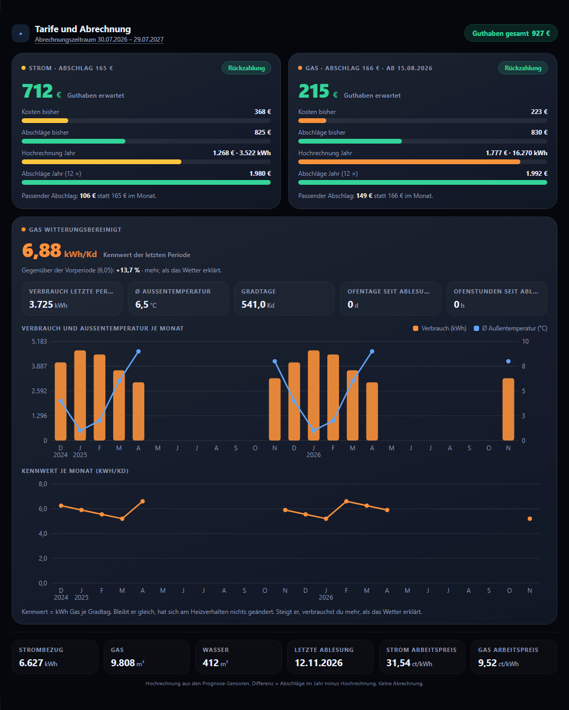

## Mietwohnung, nur Strom

```yaml
type: custom:tarif-cockpit-card
title: Stromabschlag
period_start: input_datetime.abr_strom
strom:
  cost: sensor.kosten_strom_abrechnungsjahr
  advance_paid: sensor.abschlage_strom_abrechnungsjahr
  forecast_cost: sensor.prognose_strom_kosten
  forecast_kwh: sensor.prognose_strom_verbrauch
  advance: input_number.abschlag_strom
```

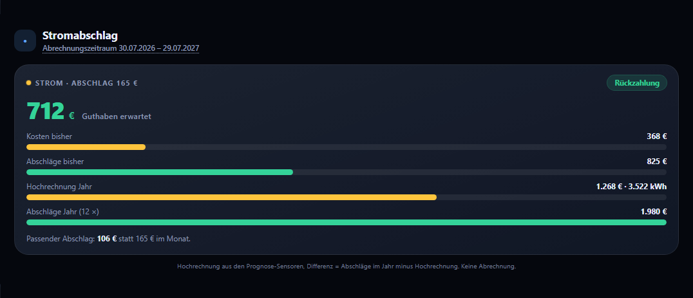

## Strom, Gas und Wasser, Wasser mit 11 Abschlägen

```yaml
type: custom:tarif-cockpit-card
period_start: input_datetime.abr_strom
strom: { cost: …, advance_paid: …, forecast_cost: …, forecast_kwh: …, advance: … }
gas: { cost: …, advance_paid: …, forecast_cost: …, forecast_kwh: …, advance: … }
wasser:
  cost: sensor.kosten_wasser_abrechnungsjahr
  advance_paid: sensor.abschlage_wasser_abrechnungsjahr
  forecast_cost: sensor.prognose_wasser_kosten
  advance: input_number.abschlag_wasser
  months: 11
footer:
  - { name: Strombezug, entity: sensor.zahler_strombezug }
  - { name: Gas, entity: sensor.zahler_gas }
  - { name: Wasser, entity: sensor.zahler_wasser }
```

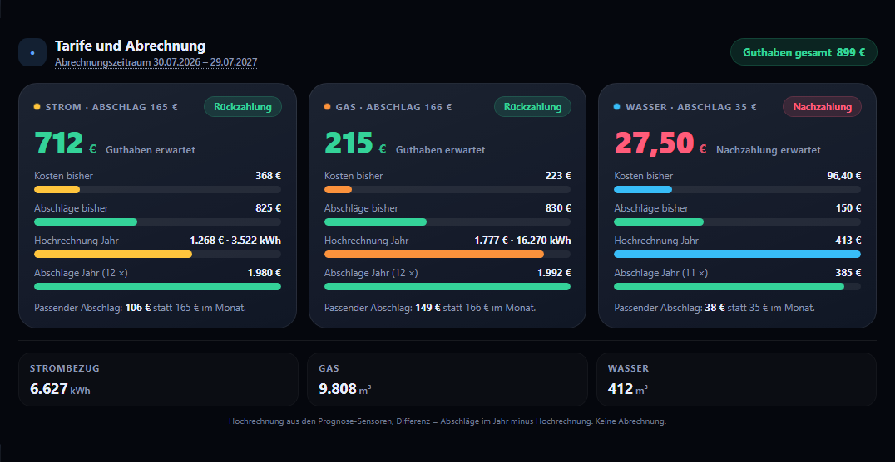

## Nachzahlung erwartet

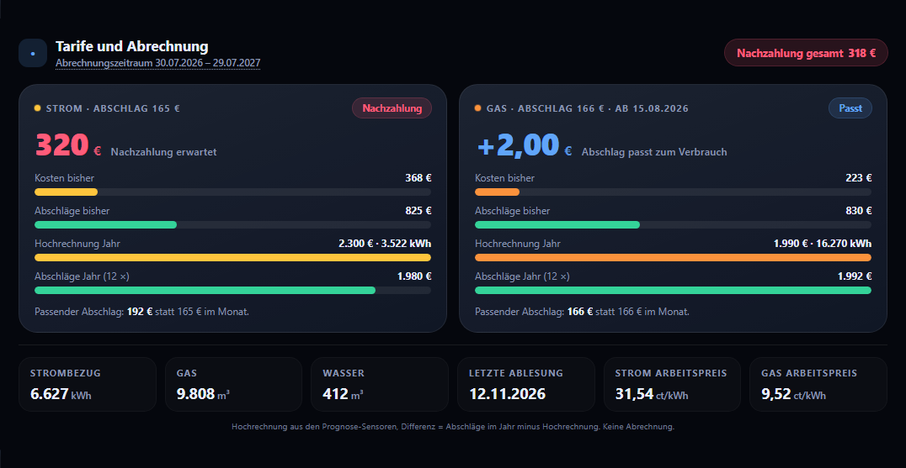

## Prognose nicht verfügbar

Ist ein Prognose-Sensor nicht verfügbar, zeigt die Kachel „Noch keine Prognose“. Das Gesamturteil oben fällt dann weg, weil nur ein Medium ein Urteil hat.

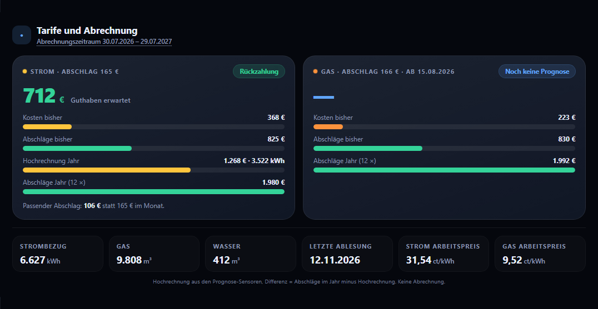

## Frisch hinzugefügt, ohne passende Sensoren

Die Karte schlägt beim Hinzufügen passende Sensoren vor. Findet sie keine, zeigt sie diesen Hinweis, und der Editor öffnet mit dem Assistenten.


## Editor

| Strom fertig eingerichtet | Farbschema | Alle Felder | Auswertung |
|---|---|---|---|
| 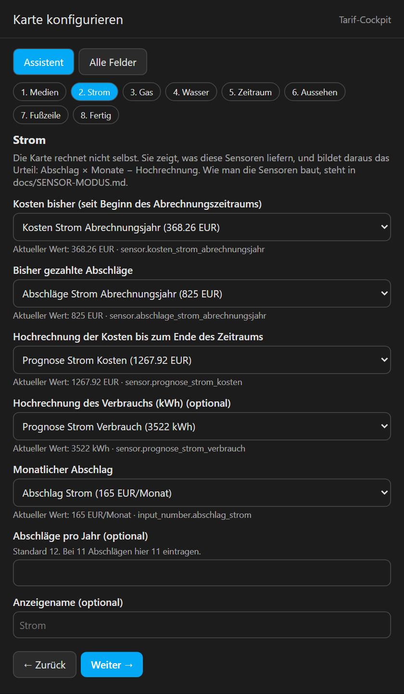 | 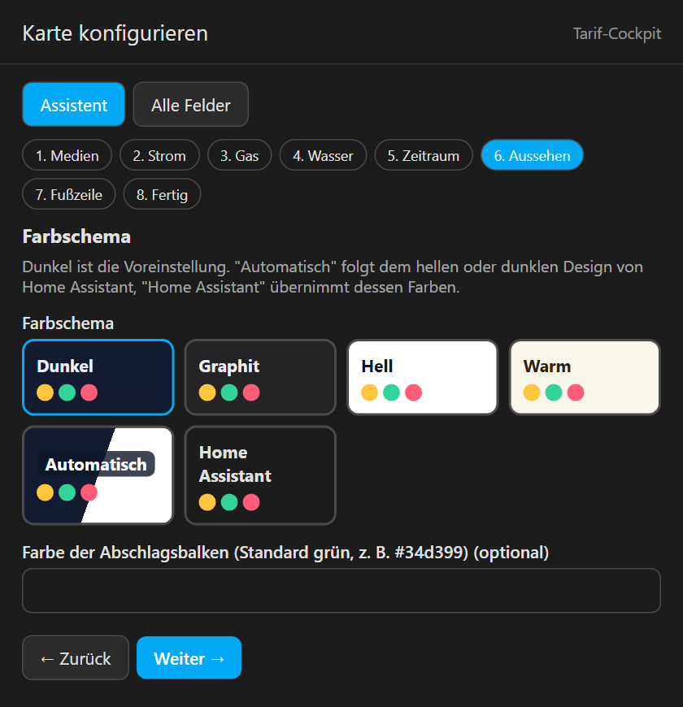 | 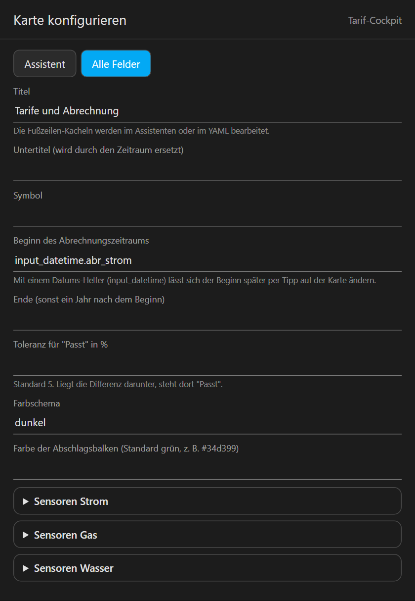 | 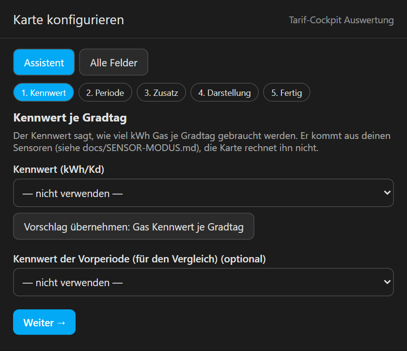 |

## Auswertung im hellen Schema, Übersicht in Graphit

| Auswertung hell | Graphit |
|---|---|
| 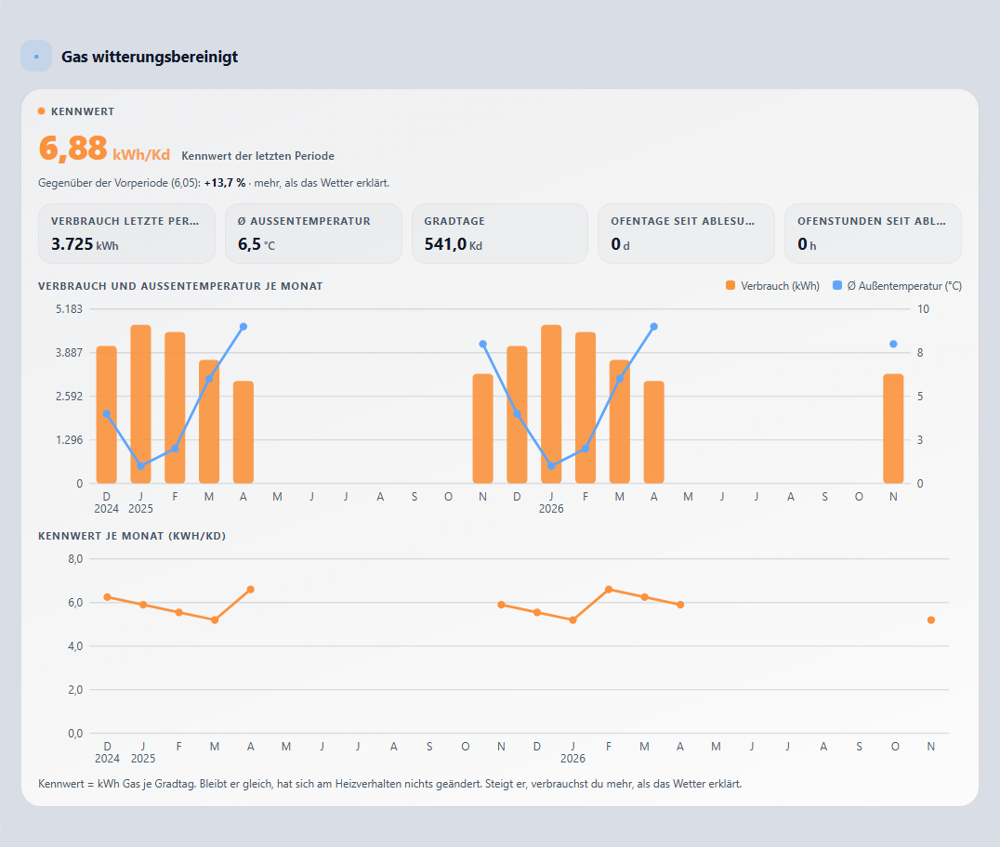 | 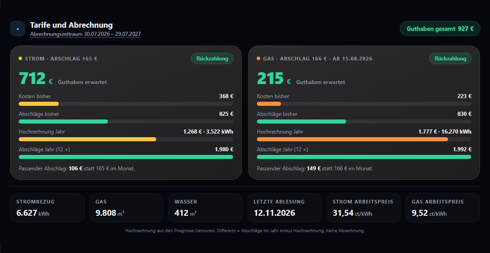 |

## Schmale Spalte und englische Oberfläche

| Schmal | Englisch |
|---|---|
| 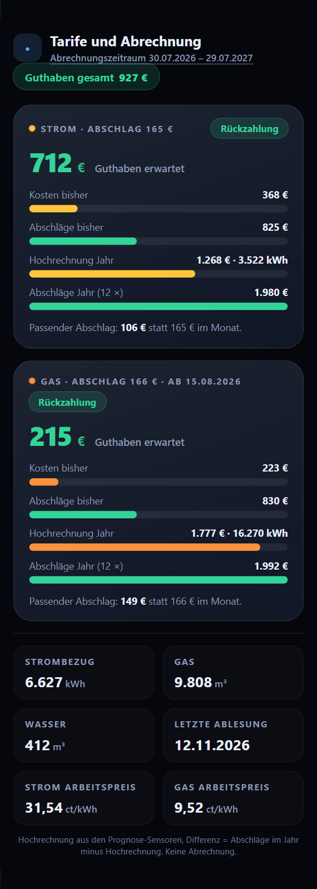 | 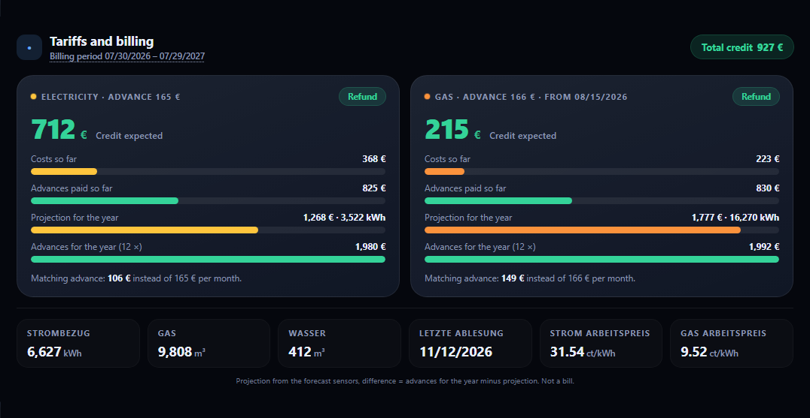 |
