# Einrichtung Schritt für Schritt (ab 0.7, Wärmeerzeuger ab 0.8)

Diese Anleitung führt durch eine Einrichtung **ohne YAML**: Haushalt, Zähler mit Vertrag, Preisen und Abschlägen, Karte im Dashboard. Die Bilder stammen aus dem Abnahme-Durchlauf in einer frischen Home-Assistant-Testinstanz (2026.11, deutsche Oberfläche), den `tools/abnahme.py` automatisch durchklickt.

Beispiel: Haus mit Gasheizung, Stromzähler ohne eigenen Sensor (nur Ablesungen), Jahresverbrauch laut letzter Rechnung 3.500 kWh, Abrechnung zum festen Stichtag 30.07., Abschlag 85 € im Monat.

Voraussetzung: Tarif-Cockpit ist über den Marketplace installiert und Home Assistant neu gestartet (siehe [README](../README.md#installation)).

## 1. Haushalt anlegen

Einstellungen → Geräte & Dienste → **Integration hinzufügen** → „Tarif-Cockpit“.

Zuerst kommen ein paar Fragen statt Fachbegriffe. Die Antworten steuern die folgenden Schritte: Wer nicht heizt, bekommt keinen Klima-Schritt; eine Wallbox als Unterzähler wird nur angeboten, wenn du eine angibst; der Rhythmus der Abschläge wird beim Zähler vorbelegt.

| Fragen zum Haushalt | Klima (nur wenn geheizt wird) | Abschluss |
|---|---|---|
| 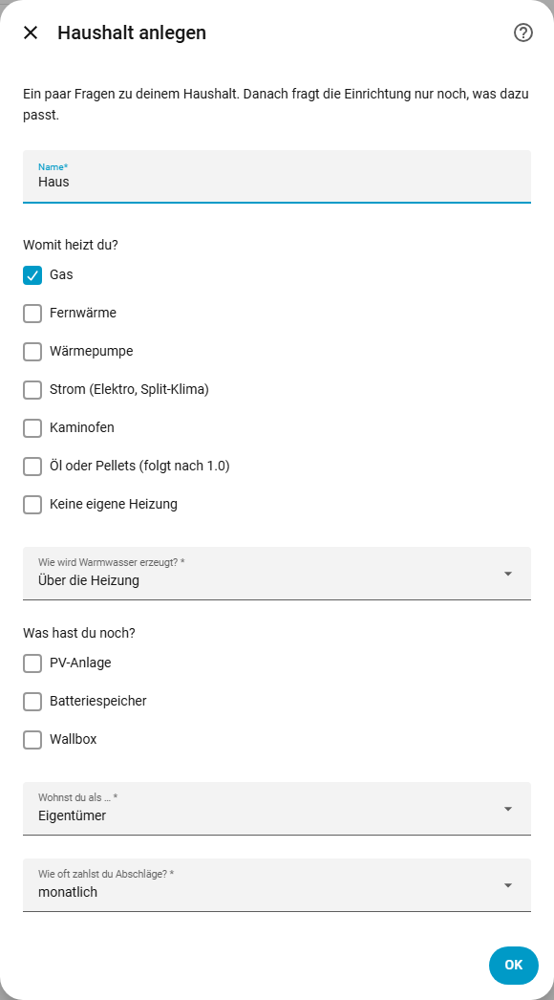 | 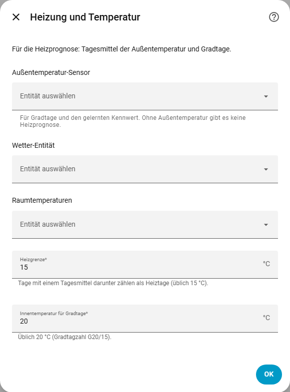 | 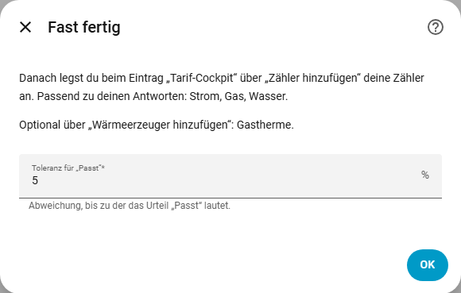 |

- **Klima:** Außentemperatur und Wetter sind optional, werden für die Gasprognose aber gebraucht (Gradtage). Heizgrenze und Innenbezug passen meist so.
- **Abschluss:** Toleranz für das Urteil „passt“. Darüber steht, welche Zähler aus deinen Antworten folgen.

Alles lässt sich später unter **Konfigurieren** am Eintrag ändern; die Integration lädt dann neu, gespeicherte Daten bleiben.

## 2. Zähler hinzufügen

Beim Eintrag „Tarif-Cockpit“ → **Zähler hinzufügen**. Für jeden Zähler (Strom, Gas, Wasser, Fernwärme) einmal.

| Medium | Name und Sensor | Einheit |
|---|---|---|
| 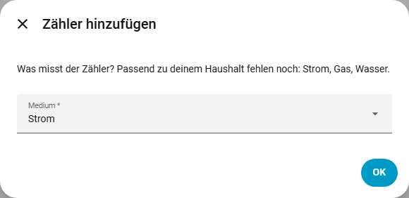 | 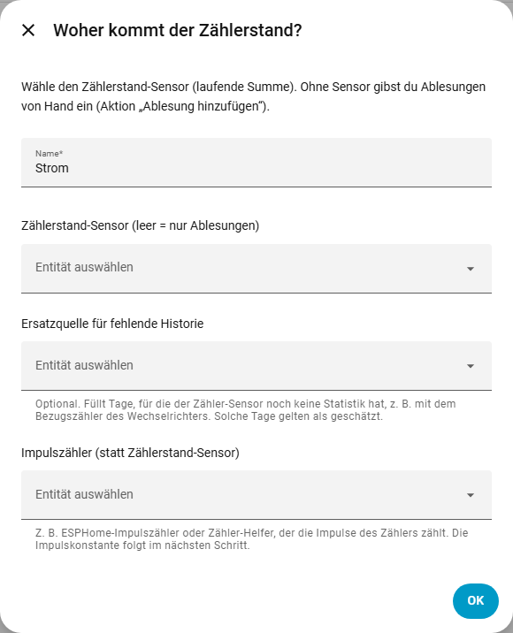 | 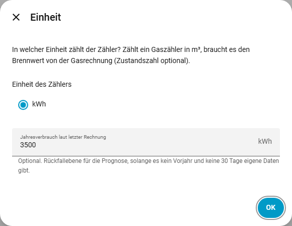 |

- **Medium:** vorbelegt mit dem ersten Zähler, der laut deinen Antworten noch fehlt.
- **Sensor:** der Zählerstand-Sensor (z. B. vom Smart Meter). Ohne Sensor („nur Ablesungen“) trägst du Stände später mit der Aktion `tarif_cockpit.add_ablesung` ein. Die **Ersatzquelle für fehlende Historie** hilft, wenn der Sensor noch kein Jahr Daten hat.
- **Einheit:** Gas in m³ braucht den Brennwert von der Gasrechnung. Der **Jahresverbrauch laut letzter Rechnung** ist optional und dient als Rückfallebene der Prognose, solange es weder Vorjahr noch 30 Tage eigene Daten gibt.

| Vertrag | Preise | Abschläge |
|---|---|---|
| 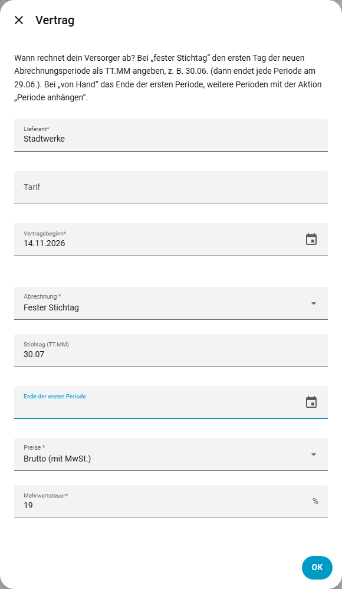 | 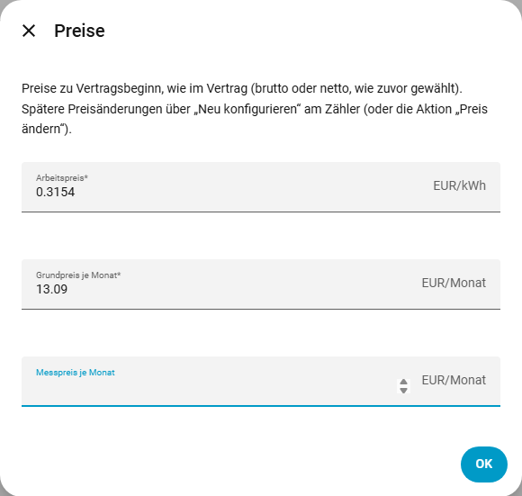 | 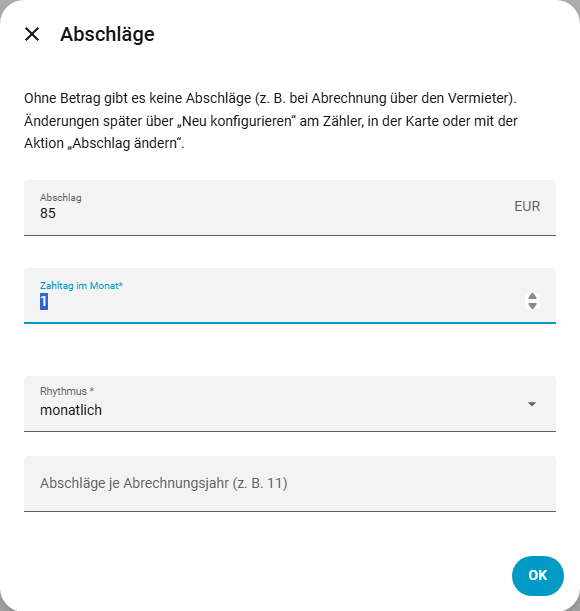 |

- **Vertrag:** „Wann rechnet dein Versorger ab?“ Vertragsjahr, Kalenderjahr (erstes Jahr als Rumpfjahr), **fester Stichtag** (erster Tag der neuen Periode als TT.MM) oder von Hand.
- **Preise:** wie im Vertrag, brutto oder netto.
- **Abschläge:** Betrag, Zahltag, Rhythmus. Ohne Betrag gibt es keine Abschläge (z. B. bei Abrechnung über den Vermieter).

| Startstand | Zusammenfassung |
|---|---|
| 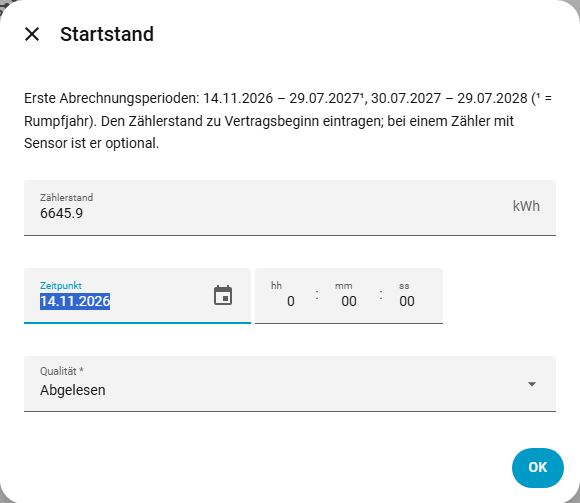 | 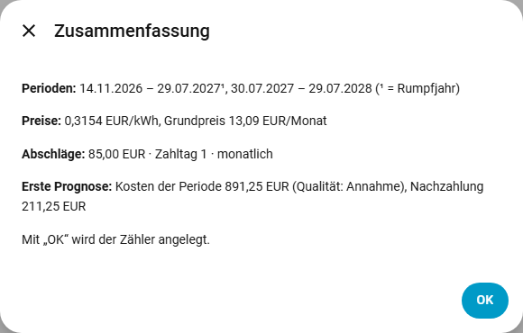 |

- **Startstand:** Zählerstand zu Vertragsbeginn, mit Vorschau der ersten Abrechnungsperioden (¹ = Rumpfjahr). Bei einem Zähler mit Sensor optional.
- **Zusammenfassung:** Perioden, Preise, Abschläge und eine **erste Prognose mit Qualität**, gerechnet wie nach dem Speichern, aber ohne etwas zu speichern. Hier: Kosten der Periode bis 29.07.2027 894,70 €, bei 8 × 85 € Abschlag eine Nachzahlung von 214,70 € (Qualität „Annahme“, weil nur der Jahresverbrauch bekannt ist). Die Karte zeigt danach auch die Menge (2.484 kWh).

### Später ändern: „Neu konfigurieren“ am Zähler

Das Stift-Symbol am Zähler öffnet ein Menü:

| Menüpunkt | Wozu |
|---|---|
| Stammdaten | Name, Ersatzquelle, Brennwert, Jahresverbrauch |
| Anbieter wechseln | Wechseldatum, Wechselablesung (echt oder geschätzt), neuer Vertrag mit Abrechnungsregel, Preise und Abschlag des neuen Vertrags. Der alte Vertrag endet am Vortag mit einer Schlussperiode. Ein Wechsel in eine bereits beendete Periode wird gleich im ersten Schritt abgelehnt. Liegt der Wechsel in der Zukunft, trägst du den Zählerstand erst danach ein (Aktion „Ablesung hinzufügen“). |
| Preis ändern | neue Preise ab einem Datum; vorbelegt mit den laufenden Preisen, damit nichts verloren geht |
| Abschlag ändern | neuer Abschlag ab einem Datum; Zahltag und Rhythmus sind mit den laufenden Werten vorbelegt |

Die Formulare rufen dieselbe Logik auf wie die gleichnamigen Aktionen (`set_preis`, `set_abschlag`, `add_folgevertrag`).

## 3. Karte ins Dashboard

Dashboard → **Bearbeiten** → **Karte hinzufügen** → Reiter „Nach Karte“ → „Tarif-Cockpit“ suchen. (Das automatische Dashboard „Übersicht“ von Home Assistant 2026 nimmt keine eigenen Karten; dafür unter Einstellungen → Dashboards ein eigenes anlegen.)

| Karte wählen | Editor mit Reiter „Integration“ | Karte im Dashboard |
|---|---|---|
| 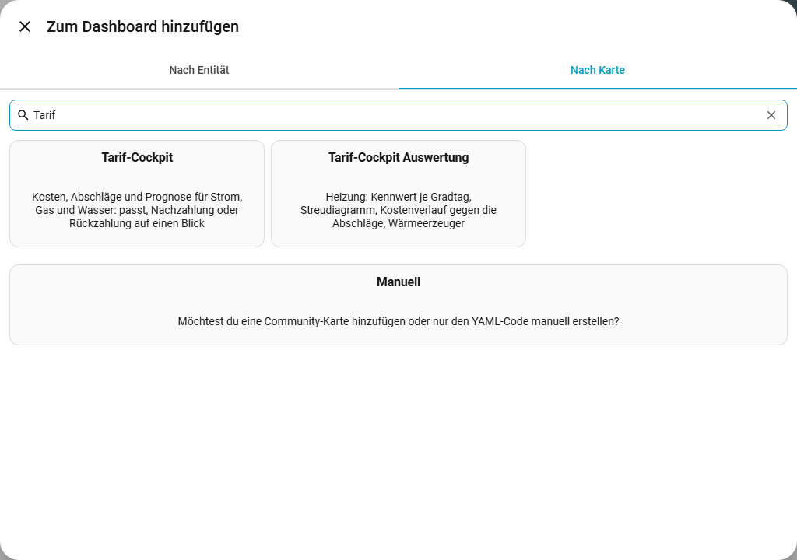 | 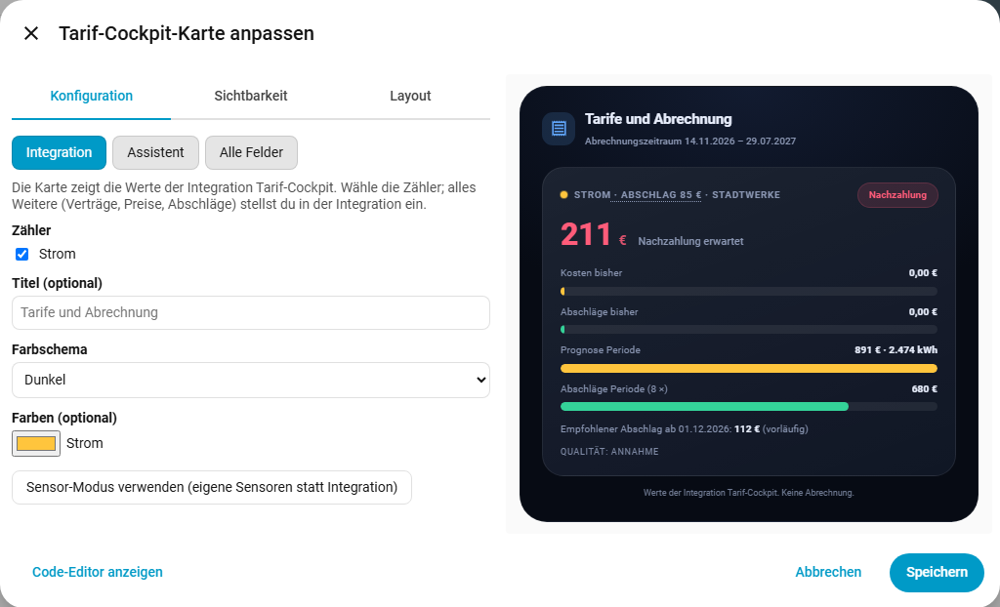 | 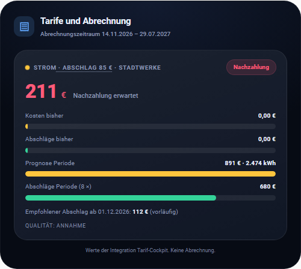 |

Ist die Integration eingerichtet, öffnet der Editor mit dem Reiter **Integration**: Zähler wählen (vorgeschlagen sind alle Hauptzähler), Titel, Farbschema, Farben. Mehr ist nicht nötig. Eine bestehende Karte im Sensor-Modus stellt der Reiter erst nach Rückfrage um; „Sensor-Modus verwenden“ wechselt zurück zu „Alle Felder“; die Karte zeigt, was die Integration rechnet. Das gespeicherte YAML ist kurz:

```yaml
type: custom:tarif-cockpit-card
integration: true
```

Die Auswertungskarte („Tarif-Cockpit Auswertung“) geht genauso; sie nimmt den Gas- oder Fernwärmezähler.

## 4. Abschlag in der Karte ändern

Ein Tipp auf „Abschlag 85 €“ öffnet einen kleinen Dialog: neuer Betrag (vorbelegt mit dem empfohlenen Abschlag) und „Gültig ab“ (vorbelegt mit dem nächsten Zahltag). „Speichern“ ruft `tarif_cockpit.set_abschlag` auf; lehnt die Integration ab (z. B. ein Datum in einer beendeten Periode), steht der Grund im Dialog. Der Dialog steht nur Administratoren zur Verfügung.

| Dialog | Danach |
|---|---|
| 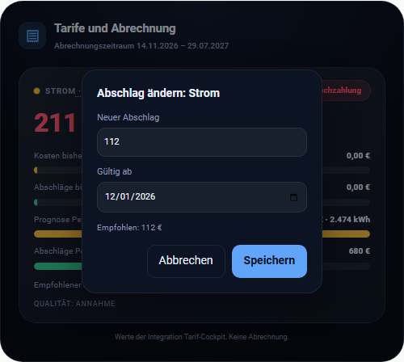 | 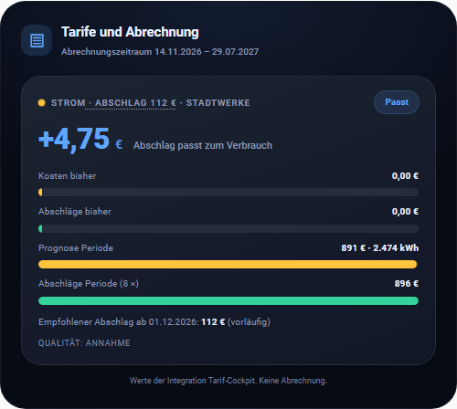 |

Mit 112 € statt 85 € ab Dezember passt die Periode: +1,30 € Guthaben erwartet.

## 5. Wärmeerzeuger (optional, ab 0.8)

Beim Eintrag „Tarif-Cockpit“ → **Wärmeerzeuger hinzufügen**: Gastherme, Wärmepumpe, Split-Klima, Fernwärme, Kaminofen oder Elektroheizung. Vorgeschlagen wird, was zu den Antworten beim Haushalt passt. Wärmeerzeuger sind optional; sie trennen eingesetzte Energie, Wärme und Entlastung und machen die Gasprognose genauer, wenn ein Kaminofen oder ein Split-Klima mitheizt.

| Art | Leistung (Typschild) | Messwerte (optional) |
|---|---|---|
| 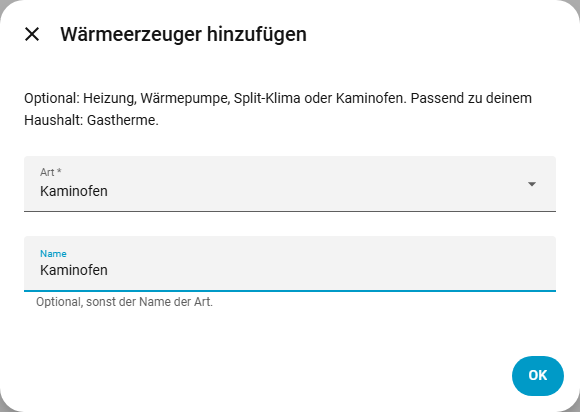 | 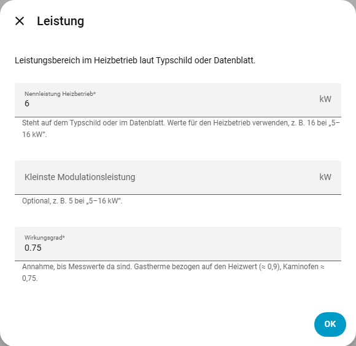 | 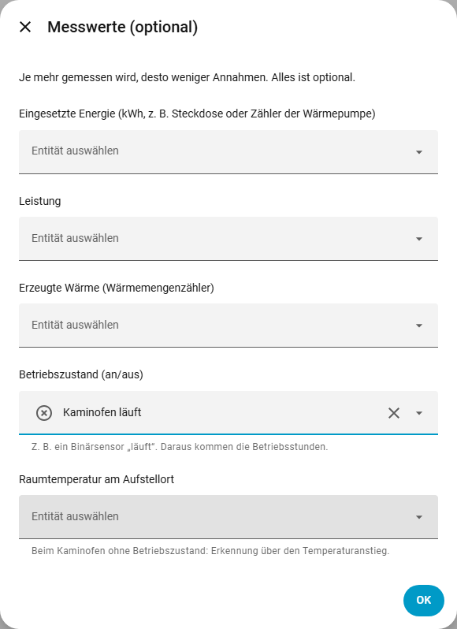 |

| Kaminofen | Zusammenfassung | Split-Klima: Energie aus dem Haushaltsstrom |
|---|---|---|
| 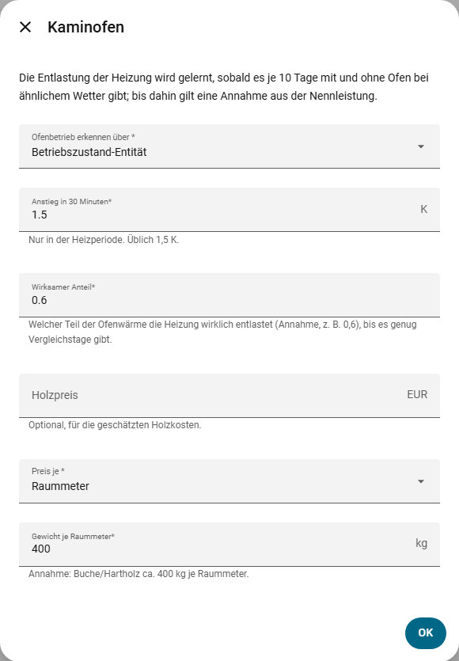 | 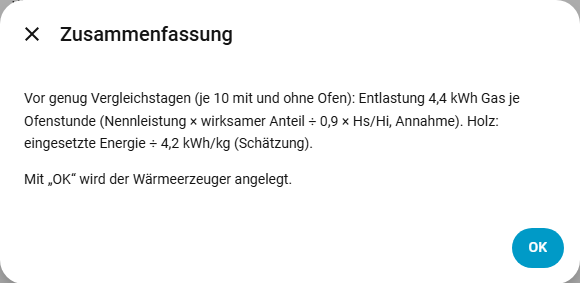 | 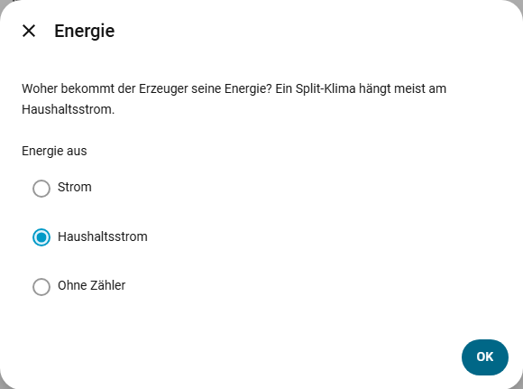 |

- **Energie:** eigener Zähler (Gastherme am Gaszähler, Wärmepumpe am WP-Zähler) oder **Haushaltsstrom** (vorbelegt bei Strom-Erzeugern). Ein eigener Stromzähler gilt dann komplett als Heizstrom, also nur den WP-Zähler wählen, nicht den Hauszähler. Am Haushaltsstrom wird der witterungsabhängige Anteil vor der Grundlast abgezogen und über die Gradtage fortgeschrieben; mit einem eigenen Energie- oder Leistungssensor zählt dessen Messung.
- **Leistung:** Nennleistung im Heizbetrieb laut Typschild (z. B. 16 bei „5–16 kW“). Bei der Gastherme wählst du, ob die Angabe die Nennwärmeleistung (Wärmeabgabe) oder die Nennwärmebelastung (Gaseinsatz) ist; umgerechnet wird mit Hs/Hi = 1,11.
- **Messwerte:** eingesetzte Energie, Leistung, erzeugte Wärme, Betriebszustand, Raumtemperatur. Optional; je mehr gemessen wird, desto weniger Annahmen. Der Kaminofen braucht den Betriebszustand oder die Raumtemperatur am Aufstellort.
- **Kaminofen:** Betrieb aus der Betriebszustand-Entität (z. B. ein Binärsensor „Kaminofen läuft“) oder aus dem Temperaturanstieg im Raum (≥ 1,5 K in 30 Minuten, nur in der Heizperiode). Die Entlastung der Gasheizung wird gelernt, sobald es je 10 Tage mit und ohne Ofen bei ähnlichen Gradtagen gibt; bis dahin gilt eine Annahme aus Nennleistung × wirksamem Anteil, deutlich als Annahme gekennzeichnet. Holz und Holzkosten sind eine Schätzung.
- **Split-Klima/Wärmepumpe:** Wärme = Strom × COP (Annahme bis ein Wärmemengenzähler da ist). Eine Entlastung der Gasheizung gibt es erst, wenn sie aus deinen Daten gelernt ist (Vergleichstage), nie aus dem COP allein.

Jeder Wärmeerzeuger ist ein eigenes Gerät mit den Sensoren eingesetzte Energie, Wärme, Entlastung, Betriebsstunden und Betriebstage; der Kaminofen zusätzlich mit Holz und Holzkosten (geschätzt).

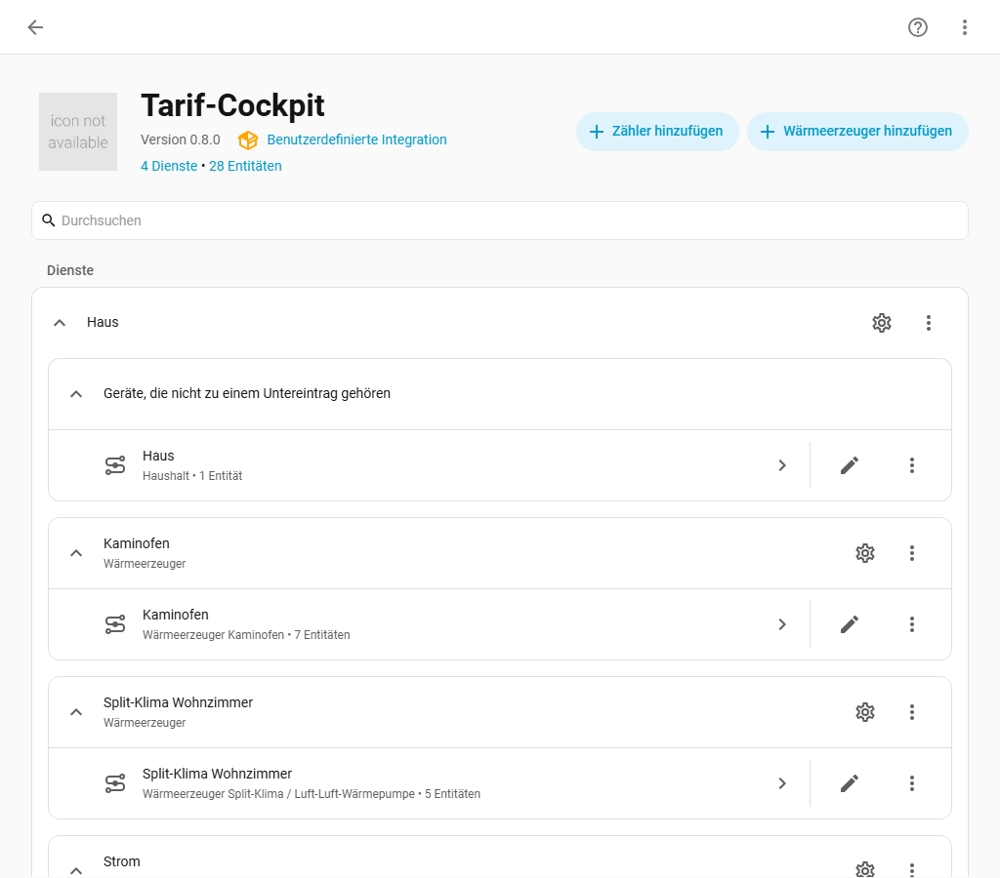

## 6. Auswertungskarte

Dashboard → Karte hinzufügen → „Tarif-Cockpit Auswertung“. Der Editor öffnet mit dem Reiter **Integration**; vorgeschlagen wird der Gas- oder Fernwärmezähler, ohne diese ein Stromzähler mit Wärmepumpe oder Split-Klima.

| Editor | Karte (frisch eingerichtet, Kennwert wird noch gelernt) |
|---|---|
| 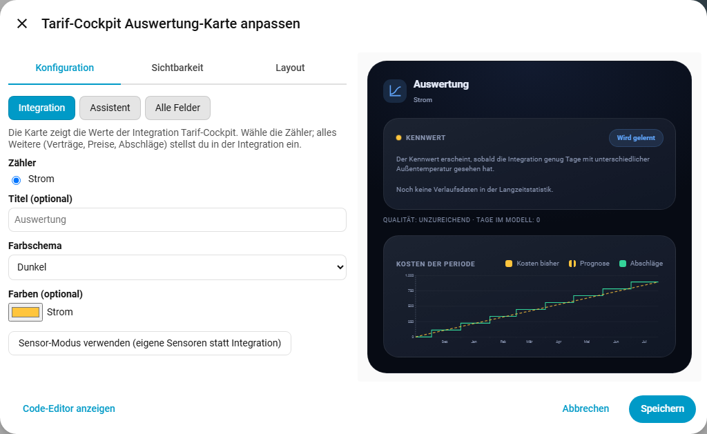 | 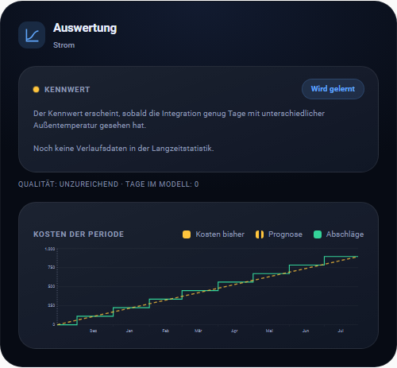 |

Die Karte zeigt den gelernten Kennwert, die Warmwasser-Grundlast (nur wenn Warmwasser über die Heizung läuft), den temperaturbereinigten Kennwert, ein **Streudiagramm** Verbrauch über Gradtage mit Regressionsgerade und Qualität, den **Kostenverlauf** der Periode (Ist, Prognose, Abschlags-Treppe) und je Wärmeerzeuger Eingang, Wärme und Entlastung. Mit Daten sieht das so aus: [Beispiele](BEISPIELE.md#heizung-gas-mit-kaminofen-und-split-klima-08).

## Hinweise

- Texte, die die Integration selbst einsetzt (z. B. die Zählernamen im Abschluss-Schritt, Zahlen in der Zusammenfassung), folgen der **Systemsprache** von Home Assistant (Einstellungen → System → Allgemein), nicht der Sprache deines Profils.
- Die Karten lädt die Integration selbst; ein Eintrag unter Dashboard-Ressourcen ist nicht nötig. Nach einem Update einmal den Browser-Cache leeren (Strg+F5).
